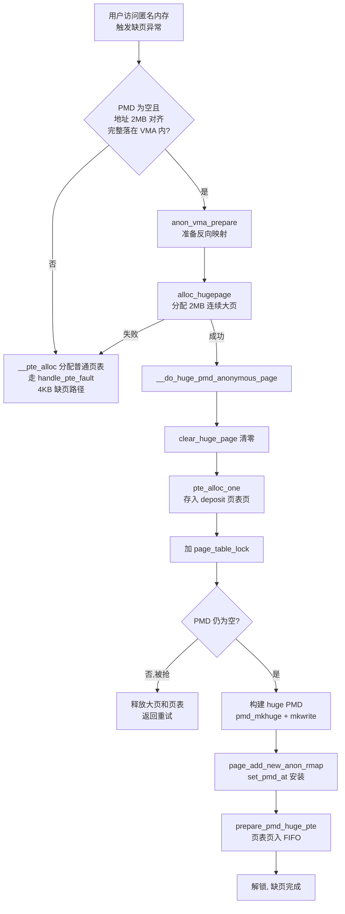
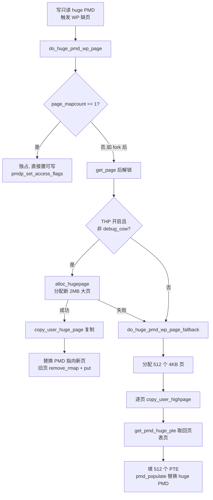
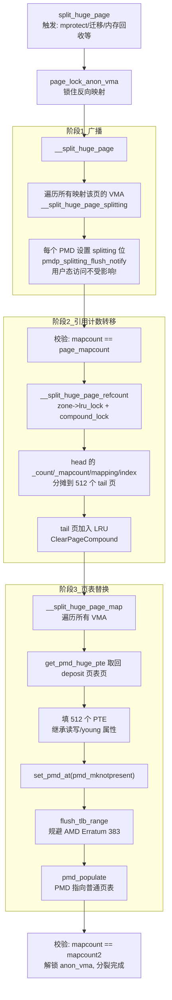

# THP - transparent huge pages

透明大页 —— 简介、关键函数与整体流程

---

## 一、简介

这份代码是 Linux 内核 **透明大页** 的早期实现（`mm/huge_memory.c`，约 Linux 2.6.38，Red Hat / Andrea Arcangeli 的原创工作）。

**核心思想**：让内核自动用 2MB 大页（x86-64 上一个 PMD 覆盖 512 个 4KB 页）来映射匿名内存，**应用程序完全无感知**，从而：

- 减少 TLB miss（一条 TLB 项覆盖 2MB 而非 4KB）
- 减少页表遍历开销
- 主要受益者是 KVM 虚拟化场景

**与 Hugetlbfs 的区别**：Hugetlb 需要预留内存 + 应用显式调用 `mmap(SH_HUGETLB)`；THP 完全透明，随时可分配、可**分裂回 4KB 小页**。

**文件结构总览**：

| 模块 | 功能 |
|---|---|
| sysfs / 启动参数 | `enabled`（always/madvise/never）、`defrag`、`debug_cow` 配置 |
| 缺页处理 | 匿名缺页时直接分配大页并安装 huge PMD |
| 写时复制（COW） | fork 后写大页时的复制处理 |
| 分裂 | 2MB 大页 → 512 个 4KB 小页（最复杂的部分） |
| 解映射 | munmap/exit 时回收大页 |

---

## 二、关键函数介绍

### 1. 配置管理

| 函数 | 说明 |
|---|---|
| `setup_transparent_hugepage()` | 解析内核启动参数 `transparent_hugepage=always/madvise/never` |
| `double_flag_show/store()` | sysfs 读写通用实现，`[always]` 方括号表示当前生效模式 |
| `hugepage_init()` | 在 `/sys/kernel/mm/transparent_hugepage/` 下创建属性组 |

### 2. 缺页路径

| 函数 | 说明 |
|---|---|
| `do_huge_pmd_anonymous_page()` | **入口**。检查地址是否 2MB 对齐且完整落在 VMA 内 → 分配大页；否则回退到普通 4KB 缺页 |
| `__do_huge_pmd_anonymous_page()` | 清零大页、构建 huge PMD（`pmd_mkhuge`）、建立反向映射、挂入 `pmd_huge_pte` FIFO |
| `alloc_hugepage()` | `GFP_TRANSHUGE` 分配 2MB 连续内存；`defrag=0` 时去掉 `__GFP_NOWAIT` 避免积极回收 |
| `prepare_pmd_huge_pte()` / `get_pmd_huge_pte()` | 管理随大页一起“存入”的页表页（deposit），FIFO 队列，分裂时取回 |

### 3. fork 与 COW

| 函数 | 说明 |
|---|---|
| `copy_huge_pmd()` | fork 时复制 huge PMD：父子双方写保护（`pmdp_set_wrprotect`）、引用计数 +1；若正在分裂则等待 |
| `do_huge_pmd_wp_page()` | 写保护缺页：mapcount==1 → 直接改权限重用；否则分配新大页复制（或走 fallback） |
| `do_huge_pmd_wp_page_fallback()` | 分配 512 个 4KB 页逐页复制，把 huge PMD 替换成普通页表 |

### 4. 分裂—— 最核心、最精妙的部分

| 函数 | 说明 |
|---|---|
| `split_huge_page()` | **对外入口**：锁 anon_vma → 调 `__split_huge_page()` |
| `__split_huge_page()` | 三步走：① 标记 splitting → ② 转移引用计数 → ③ 替换页表映射 |
| `__split_huge_page_splitting()` | 在所有映射该页的 PMD 上设置 **splitting 位**（保留位，不清 present 位），保证用户态访问不中断，但其他 CPU 会在此位上等待 |
| `__split_huge_page_refcount()` | 把 head 页的 `_count`/`_mapcount`/`mapping`/`index`/标志位分摊到 512 个 tail 页，最后 `ClearPageCompound` |
| `__split_huge_page_map()` | 用 deposit 的页表页填 512 个 PTE，然后：**置 notpresent → flush TLB → pmd_populate**（规避 AMD Erratum 383：同一地址不允许同时存在大小页 TLB 项） |
| `page_check_address_pmd()` | 在指定 mm 中查找映射某大页的 PMD，并校验 splitting 状态 |

### 5. 其他

| 函数 | 说明 |
|---|---|
| `zap_huge_pmd()` | munmap/exit 时拆除 huge PMD，释放大页和 deposit 的页表页 |
| `follow_trans_huge_pmd()` | GUP（get_user_pages）路径：跟随 huge PMD 找到具体 4KB 子页 |
| `__split_huge_page_pmd()` | 供外部（如 mprotect、迁移）强制分裂某个 PMD |

---

## 三、整体流程图

### 3.1 匿名缺页 → 建立大页映射



### 3.2 写时复制



### 3.3 大页分裂—— 三阶段流水线



### 3.4 关键数据结构关系

```
        mm_struct
       ┌─────────────────────┐
       │ page_table_lock     │◄──── 全程用这一把锁保护 PMD 操作
       │ pmd_huge_pte ───────┼──► pgtable ─► pgtable ─► ...   (deposit FIFO:
       │                     │    页表页"存入/取回"配对使用)
       └─────────────────────┘
                 │
        PGD → PUD → PMD ════════════► [ 2MB compound page ]
                 │                        ┌──────────────┐
              huge PMD                    │ head page    │ _count/_mapcount
              (pmd_mkhuge)                │  + 511 tail  │ 集中在 head
                                         └──────────────┘
              分裂后:
        PMD → 页表(512 PTE) ──► 512 个独立 4KB page
```

---

## 四、设计亮点小结

1. **透明性**：应用零修改，随时可建大页、随时可退回小页
2. **deposit 机制**：大页建立时预存一张页表页，分裂时直接取回，避免分裂路径上分配失败
3. **splitting 位**：用 PMD 保留位（而非清 present 位）标记分裂中，**用户态访问全程不中断**，其他内核路径看到该位则等待
4. **TLB 安全**：先 notpresent → flush TLB → 再 populate，避免同一虚拟地址同时存在大小两种 TLB 项（AMD 383 号勘误）
5. **内存屏障密集**：`smp_mb()`/`smp_wmb()` 保证 PageTail 清除、mapcount 转移等操作的跨 CPU 可见性顺序


## TLB - tranparent lookaside buffer

  

## refs

- [lwn_transparent_huge_pages](https://lwn.net/Articles/423584/)  
- [lwn_transparent_huge_pages_reference_counting](https://lwn.net/Articles/619738/)
