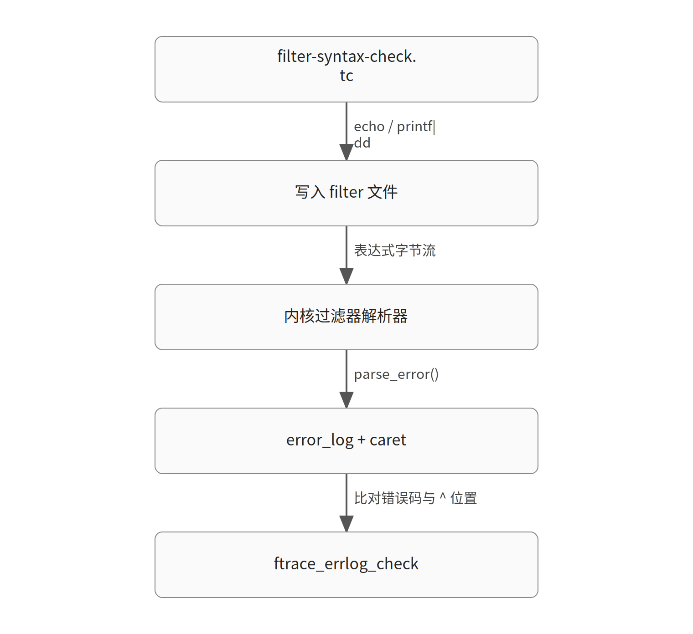

# 用 ^ 标记错误位置：ftrace 事件过滤器语法检查自测用例的设计

> 生成于 2026-10-29T10:34:07Z｜模型 glm-5.3｜内核 commit 89a312991dc6e638a36adc43ccb91dbc25504c04｜证据 3 份（一手 3 / 二手 0）

对应日报：`digest/2026-10-29.md`

原文：[[PATCH v4 15/15] selftests/ftrace: Add event filter syntax check test case](https://lore.kernel.org/all/179323798449.740114.5416715723328926616.stgit@devnote2/)

## 1. 必要背景与旧机制

【背景补充，需核对】 ftrace 允许用户向 tracefs 的 events/<子系统>/<事件>/filter 文件写入布尔表达式（如 common_pid == 0），由内核 kernel/trace/trace_events_filter.c 中的解析器将其编译为谓词，在事件发生时快速判断是否记录。解析失败时，内核通过 error_log 机制报告错误，并用 ^（caret）在出错的表达式中标出出错位置。ftracetest 是 tools/testing/selftests/ftrace 下的 shell 测试框架，每个 .tc 文件是一个独立用例，可声明对 tracefs 特性的依赖，缺失时自动跳过。本补丁是一个 15 补丁系列（v4）的最后一个：作者在封面信中说明，该系列修复 trace 事件过滤器解析器与谓词求值的多处 bug，并附带一个新的 ftrace 自测用例覆盖过滤器语法检查；前 8 个是真正的 bug 修复，9-14 是错误消息方面的清理与改进，第 15 个就是本补丁的测试。作者还注明这些 bug 的识别与修复信的撰写有 LLM 编码助手参与。 [材料 3] [材料 3]

## 2. 问题与触发场景

【事实】 该系列前 14 个补丁修复了过滤器解析与匹配的多处缺陷：固定大小字符串的 MATCH_END_ONLY 正则匹配、process_system_preds() 的假成功返回、CPUS{} 比较中 OP_NE 对越界 CPU 的处理、所有 -EINVAL 路径都要调用 parse_error()（否则 error_log 里出现 "Error: (0)"）、运算符后缺操作数导致的越界读、函数事件过滤器的引号解析、换行后非空白字符的处理，以及多处错误位置（caret 列号）计算错误。这些行为修复之后，需要一个系统性的回归测试来锁定它们：既验证合法表达式能被接受，也验证畸形表达式（空过滤器、缺字段、括号/引号不配对、悬空逻辑运算符、非法字段/值/cpulist）在 error_log 中报告正确的错误码和 caret 位置，还要覆盖多行输入的换行截断和子系统级无效过滤器的错误返回。补丁说明中明确列出了这些验证目标。 [材料 1] [材料 3]

## 3. 本次改动

【事实】 新增 tools/testing/selftests/ftrace/test.d/filter/filter-syntax-check.tc，共 100 行。核心是 check_error() 封装：调用 ftracetest 框架自带的 ftrace_errlog_check 辅助函数，把待测表达式和目标 filter 文件路径传入；表达式中嵌入一个 ^ 字符标记期望的出错位置，辅助函数据此断言 error_log 中既出现指定错误码，caret 也落在正确列上。测试分几层：先写一组合法表达式（括号嵌套、~ 通配匹配、空串匹配 prev_comm == ""、CPUS{0} 比较）；再按类别写畸形表达式并注释期望错误码——空/无意义表达式（NO_FILTER、INVALID_FILTER）、括号引号不配对（TOO_MANY_OPEN/CLOSE、MISSING_QUOTE）、悬空逻辑运算符与空操作数（TOO_MANY_PREDS、INVALID_VALUE）、非法字段/操作数类型（FIELD_NOT_FOUND、EXPECT_DIGIT、EXPECT_STRING、ILLEGAL_FIELD_OP）、CPUS{} 语法错误（MISSING_BRACE_OPEN/CLOSE、INVALID_CPULIST，含越界 CPU 99999）。函数事件过滤器部分用 if [ -f events/kmem/kmem_cache_free/filter ] 条件执行，覆盖 NO_FUNCTION、INVALID_OP 等。多行输入用 printf | dd 直接把含换行的字节流写入 filter 文件：换行后有非空白字符必须失败，纯空白尾部则允许。最后验证子系统级 filter（events/sched/filter）对无效表达式必须返回失败。 [材料 1] [材料 1]

## 4. 为什么有效

【教学推演】 为什么用 ^ 标记位置而不只断言错误码？因为本系列补丁 11-14 修的恰恰是错误位置计算（函数过滤器的 pos + fn_pos / pos + op_pos、CPUS 解析、GLOB_WITHIN 等），如果测试只检查错误码，这些补丁的行为就没有被锁定，回归无法被发现。把 ^ 嵌入表达式字符串，让 ftrace_errlog_check 同时比对错误码和 caret 列，一个断言锁两层契约。为什么 v3 把取反管道（! cmd）换成显式的 if cmd; then exit_fail; fi？因为 ftracetest 在 POSIX sh 下运行且启用 set -e，取反管道的意外成功（命令返回 0，! 使整体为假）在 set -e 语义下可能导致测试脚本直接退出而不是报告失败，显式 if 判断才能可靠捕获"本应失败却成功"的情况。为什么多行测试用 printf | dd 而不是 echo？echo 的转义行为在各 shell 实现间不一致，而 printf 生成确定的字节流、dd 原样写入文件，这样才能精确控制写入内核的内容——包括换行符本身，从而验证补丁 09 的行为：换行后所有字符必须是空白才允许截断，否则拒绝整个输入而非原地截断。

## 5. 代价、边界与未决问题

【教学推演】 这个测试的取舍：其一，它强依赖特定事件（sched_switch 的字段、kmem_cache_free 的函数事件）和 error_log 特性，因此头部用 requires 行声明依赖，环境不满足时用例按 UNSUPPORTED 跳过而不是误报失败；函数事件部分进一步用 if [ -f ... ] 条件包裹，兼容未启用函数事件过滤的内核。其二，测试断言的是错误码字符串（如 INVALID_CPULIST、MISSING_QUOTE），这些是内核错误消息的一部分，措辞演进时测试需同步维护——这也是为什么系列把纯错误消息修复归为 cleanup 而非 bug fix，作者与维护者商定后从这些补丁上移除了 Fixes/Cc:stable 标签。其三，v3 的 shell 语义修正说明自测本身也会踩 POSIX sh 的坑，测试代码的可移植性需要与被测内核行为同等谨慎。 [材料 1] [材料 3]

## 6. 可迁移结论

【教学推演】 这是"修复 + 回归测试"配对发布的范例：一个 100 行的 shell 测试同时锁定 14 个补丁的行为契约——不只验证"报错"，还验证"报什么错、错在哪一列"。对内核测试编写者的可迁移经验有三点：第一，当被测行为包含诊断输出的位置信息时，用嵌入标记符（如 ^）的方式可以让断言精确到列；第二，在 set -e 的 POSIX sh 中，"期望失败"的检查要用显式 if 而非取反管道，否则意外成功可能被吞掉；第三，需要向 tracefs/ debugfs 写入含特殊字符（换行、引号）的原始字节时，printf | dd 比echo 更可控。另外注意：本补丁是 LKML 上的投稿（v4 系列），其合入状态未在材料中体现，引用前应自行核实。

## 图示

### 图 1：filter-syntax-check.tc 的验证链路（教学简化示意）



图示文字路径：

- filter-syntax-check.tc → echo / printf|dd → 写入 filter 文件
- 写入 filter 文件 → 表达式字节流 → 内核过滤器解析器
- 内核过滤器解析器 → parse_error() → error_log + caret
- error_log + caret → 比对错误码与 ^ 位置 → ftrace_errlog_check

## 源码与关键逻辑

### 源码 1：kernel/trace/trace_events_filter.c:1-23（commit 89a312991dc6）

```c
// SPDX-License-Identifier: GPL-2.0
/*
 * trace_events_filter - generic event filtering
 *
 * Copyright (C) 2009 Tom Zanussi <tzanussi@gmail.com>
 */

#include <linux/uaccess.h>
#include <linux/module.h>
#include <linux/ctype.h>
#include <linux/mutex.h>
#include <linux/perf_event.h>
#include <linux/slab.h>

#include "trace.h"
#include "trace_output.h"

#define DEFAULT_SYS_FILTER_MESSAGE					\
	"### global filter ###\n"					\
	"# Use this to set filters for multiple events.\n"		\
	"# Only events with the given fields will be affected.\n"	\
	"# If no events are modified, an error message will be displayed here"
```

本地内核源码上下文，用于对照上述机制；行号来自当前源码版本。

### 源码 2：tools/testing/selftests/ftrace/test.d/filter/filter-syntax-check.tc（材料 1）

```shell
diff --git a/tools/testing/selftests/ftrace/test.d/filter/filter-syntax-check.tc b/tools/testing/selftests/ftrace/test.d/filter/filter-syntax-check.tc
new file mode 100644
index 000000000000..02fb2be6e6eb
--- /dev/null
+++ b/tools/testing/selftests/ftrace/test.d/filter/filter-syntax-check.tc
@@ -0,0 +1,100 @@
+#!/bin/sh
+# SPDX-License-Identifier: GPL-2.0
+# description: event filter - test filter syntax error check
+# requires: set_event events/sched/sched_switch/filter error_log
+# flags: instance
+
+check_error() { # command-with-error-pos-by-^
+    ftrace_errlog_check 'event filter parse error' "$1" 'events/sched/sched_switch/filter'
+}
+
+# Valid filter expressions
+echo '(common_pid == 0)' > events/sched/sched_switch/filter
+echo '((common_pid == 0) && (prev_pid == 0))' > events/sched/sched_switch/filter
+echo 'prev_comm ~ "*sh"' > events/sched/sched_switch/filter
+echo 'prev_comm ~ "*"' > events/sched/sched_switch/filter
+echo 'prev_comm == ""' > events/sched/sched_switch/filter
+echo 'prev_comm ~ ""' > events/sched/sched_switch/filter
+echo 'common_pid == CPUS{0}' > events/sched/sched_switch/filter
+echo 'common_pid != CPUS{0}' > events/sched/sched_switch/filter
+echo 0 > events/sched/sched_switch/filter
+
+# Empty or meaningless filter expressions
+check_error '^()'						# NO_FILTER
+check_error '^== 1'						# INVALID_FILTER
+check_error 'common_pid ==^'					# INVALID_FILTER
+check_error 'common_pid !=^'					# INVALID_FILTER
+check_error 'common_pid >=^'					# INVALID_FILTER
+
+# Unbalanced parentheses and quotes
+check_error '^(common_pid == 1'					# TOO_MANY_OPEN
+check_error 'common_pid == 1^)'					# TOO_MANY_CLOSE
+check_error 'prev_comm == ^"bash'				# MISSING_QUOTE
+
+# Dangling logical operators and empty operands
+check_error 'common_pid == 1 &&^'				# TOO_MANY_PREDS
+check_error 'common_pid == 1 ||^'				# TOO_MANY_PREDS
+check_error 'common_pid == 1 || (common_pid == 2 && ^)'		# INVALID_FILTER
+check_error '(common_pid == ^)'					# INVALID_VALUE
+check_error 'common_pid == ^&& common_pid == 0'			# INVALID_VALUE
```

补丁正文片段，来自本次抓取材料。

## 未核实项与材料限制

- 该 v4 系列及本补丁是否已合入主线未在材料中体现，合入状态未核实。
- 测试文件中的行号区间为编者按 diff 内容推算，可能与最终提交版本有偏差。
- ftrace_errlog_check 辅助函数的具体比对逻辑（如何解析 ^ 标记）未在材料中给出，此处基于其调用形式推断。
- 各错误码（如 TOO_MANY_PREDS、INVALID_CPULIST）在内核中的产生路径属于系列其他补丁的内容，材料仅有封面信摘要，未附对应 diff。
- 源码片段未通过核对，已省略：source 代码未在一手材料中找到
- 模型未给出可核对的源码片段，已自动附上本地源码或补丁正文上下文。

## 材料

1. [一手材料] https://lore.kernel.org/all/179323798449.740114.5416715723328926616.stgit@devnote2/
   > Add a new ftracetest test case (filter-syntax-check.tc) to verify valid event filter expressions, error_log caret reporting for malformed filter expressions
   > ftrace_errlog_check 'event filter parse error' "$1" 'events/sched/sched_switch/filter'
   > # Multi-line input with non-whitespace characters after newline must fail
2. [一手材料] https://lore.kernel.org/all/179323798449.740114.5416715723328926616.stgit@devnote2/raw
3. [一手材料] https://lore.kernel.org/all/179323784538.740114.15323117974242744566.stgit@devnote2/
   > Here is the 4th version of fixes for various bugs in the trace event filter parser and predicate evaluation in kernel/trace/trace_events_filter.c, along with a new ftracetest test case covering filter syntax checks.
   > These bugs were identified and the fixes and cover letter were prepared with the assistance of an LLM coding assistant.
   > [15/15] Add filter-syntax-check.tc to ftrace selftests to test valid filters, syntax error diagnostics and caret positions, multi-line input validation, and subsystem filter error returns.
