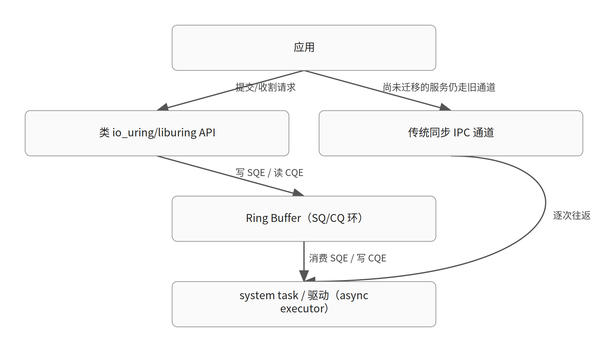

# Redox OS 的类 io_uring Ring Buffer：微内核上应用与系统服务之间的异步 I/O 通信

> 生成于 2026-10-30T02:38:23Z｜文章深读｜模型 glm-5.3｜内核 commit 89a312991dc6｜证据 1 份（一手 0 / 二手 1）

对应日报：`digest/2026-10-29.md`

原文：[Redox OS ring buffers project summary](https://lwn.net/Articles/1103359/)

## TL;DR

- Redox OS（Rust 编写的类 Unix 微内核系统）获得资助，在 system task 层实现了类 io_uring 的 Ring Buffer 支持，该阶段已于九月完成。
- 除系统服务与驱动的 Ring Buffer 机制外，还完成并演示了面向应用的类 io_uring/liburing API，以及包括驱动用异步执行器在内的支持 crate。
- 性能优化聚焦于应用与其系统服务之间更快的切换；LWN 简讯本身不含技术细节，细节由 Redox 团队自己的报告给出。

## 先修知识

*以下为理解本文所需的背景知识，属模型补充；带源码锚点的请自行核对。*

### io_uring

- **是什么**：Linux 的异步 I/O 接口：内核与应用通过一块共享内存中的提交队列（SQ）和完成队列（CQ）交换请求与结果，尽量减少系统调用次数
- **为什么这里需要**：Redox 的项目目标就是实现 'io_uring-like' 的机制，不理解 io_uring 的 SQ/CQ 共享环模型，就无法理解 Redox Ring Buffer 想复刻什么
- **在本文中的位置**：io_uring/io_uring.c 中的 io_uring_setup()（创建 ring 并返回 fd）与 io_uring_enter()（提交/等待完成）（`io_uring/io_uring.c:3092`）
- **一个例子**：应用调用 io_uring_setup(entries, params) 建环，之后把 SQE 写进 SQ、调用一次 io_uring_enter() 批量提交，内核把 CQE 写进 CQ

### SQ/CQ 与 SQE/CQE

- **是什么**：提交队列（Submission Queue）与完成队列（Completion Queue）是两个环形缓冲区；队列中的每个槽位分别是 SQE（提交条目）和 CQE（完成条目）
- **为什么这里需要**：'Ring Buffer' 在这类设计里指的就是这两个环；应用生产 SQE、消费 CQE，内核（或服务端）反之，从而实现双向无锁的低开销通信
- **在本文中的位置**：include/uapi/linux/io_uring.h 定义的 UAPI 结构与特性位（IORING_FEAT_*）（`include/uapi/linux/io_uring.h:632`）
- **一个例子**：一次 read 可以变成一个 SQE，内核完成后写一个带结果码的 CQE，应用无需再为这次 I/O 单独陷入内核

### liburing

- **是什么**：Linux io_uring 的用户态辅助库，把裸 UAPI 包装成更易用的函数（如 io_uring_get_sqe/io_uring_submit）
- **为什么这里需要**：材料说 Redox 完成了 'io_uring 和 liburing-like API'，即既做了底层环机制，也做了应用侧的易用封装层
- **在本文中的位置**：材料中作为 Redox 应用侧 API 的对标物出现
- **一个例子**：应用不直接操作环内存和内存屏障，而是调用库函数获取 SQE、填参数、提交

### Redox OS 与微内核 system task

- **是什么**：Redox OS 是用 Rust 写的类 Unix 微内核操作系统；设备驱动、文件系统等服务运行在用户态的服务进程中（材料称 system task），而非内核里
- **为什么这里需要**：微内核上每次 I/O 都要跨进程通信（IPC），同步 IPC 的往返开销是主要瓶颈，这正是引入 ring buffer 通信的动机
- **在本文中的位置**：材料中 'ring buffer communications between the application and the majority of system services' 一句
- **一个例子**：应用读文件时，请求要发给用户态的磁盘驱动服务，传统上每次请求/应答都是一次 IPC 往返

### Rust crate 与 async executor

- **是什么**：crate 是 Rust 的编译/复用单元（相当于库）；async executor 是驱动 async/await 任务的运行时，负责轮询 future、调度唤醒
- **为什么这里需要**：材料提到 'substantial work done on support crates, including an async executor for drivers'，即驱动侧的异步运行时支撑，让驱动能以异步方式消费 ring buffer 中的请求
- **在本文中的位置**：材料中支持性工作的部分
- **一个例子**：驱动服务用 executor 在等待设备完成时挂起当前任务、处理其他请求，而不是阻塞整个服务进程

### 上下文切换开销（应用  <->  系统服务）

- **是什么**：进程/任务之间切换（保存恢复寄存器、调度、缓存污染）的成本；微内核上一次 I/O 可能触发多次切换
- **为什么这里需要**：材料明确说性能优化是为了 'much faster switching between applications and their system services'，说明切换开销是 Redox 微内核 I/O 路径的核心瓶颈
- **在本文中的位置**：材料最后一段关于性能改进的描述
- **一个例子**：同步 IPC 模型下，一次请求至少涉及应用陷入内核、调度到服务、服务应答、调度回应用这几次切换

## 机制速览



### 图 1：Redox Ring Buffer 的目标通信路径（对照传统 IPC）（教学简化示意）

### 表 1：Linux io_uring 与 Redox Ring Buffer 目标对比

*左列为模型补充的 Linux 机制，右列为材料明确陈述的 Redox 目标；非逐项对等实现（教学简化示意）*

| 方面 | Linux io_uring（model 背景知识） | Redox Ring Buffer（材料陈述） |
|---|---|---|
| 通信双方 | 应用  <->  内核，共享 SQ/CQ 环 | 应用  <->  用户态系统服务/驱动 |
| 建环入口 | io_uring_setup() 返回 fd | 类 io_uring API（已完成并演示） |
| 易用封装 | liburing 库 | 类 liburing 的应用 API |
| 服务端运行时 | 内核 worker/异步基础设施 | 驱动用 async executor（crate） |
| 优化目标 | 减少 syscall 与阻塞 | 应用与系统服务间更快切换 |
| 阶段状态 | 主线成熟演进 | 第一阶段于九月完成，后续待定 |

## 背景与问题

【材料陈述】 **结论**：这是一篇 LWN 简讯：Redox OS 发布了上一年度实现类 io_uring I/O 的项目总结，理解它需要 io_uring 与微内核 IPC 两块背景。 [材料 1](https://lwn.net/Articles/1103359/)

- Redox OS 是用 Rust 编写的类 Unix 微内核操作系统，过去一年在实现类 io_uring 的 I/O；这篇 LWN 简讯转述其项目报告。
- 项目源于去年获得的一笔资助：在 system task 层开发类 io_uring 的 Ring Buffer 支持，作为应用与多数系统服务之间 ring buffer 通信的第一步。
- 该阶段工作已于九月完成，'as the last pieces were put in place'。
- 【背景补充，需核对】Linux io_uring 的核心是 SQ/CQ 两个共享内存环：应用写 SQE、内核写 CQE，io_uring_setup() 建环返回 fd，io_uring_enter() 提交/等待；Redox 想把这套模型搬到应用与用户态系统服务之间。
- 【背景补充，需核对】微内核把驱动、文件系统等放在用户态服务进程里，每次 I/O 都要跨进程通信；同步 IPC 的往返与切换开销正是 ring buffer 通信想削减的成本。

## 文章核心主张

【材料陈述】 **结论**：简讯的核心主张：Redox 已按资助目标完成第一阶段——在 system task 层落地 Ring Buffer 机制，并配套了应用侧 API、支持 crate 和性能优化。 [材料 1](https://lwn.net/Articles/1103359/)

- 资助目标被界定为：先在 system task 层实现 Ring Buffer 支持，作为通往'应用与多数系统服务之间 ring buffer 通信'的第一步。
- 作者认为该阶段已完成：机制（Ring Buffer machinery）、应用 API（类 io_uring/liburing）、支撑设施（crate 与驱动异步执行器）、性能优化四条线都有产出。
- 作者明确把技术细节留给 Redox 团队自己的报告：'But I will let the team tell you all the technical details.'——即本简讯只是导览，不是技术正文。

## 文章脉络

【材料陈述】 **结论**：按简讯叙事顺序：资助背景 → 阶段完成 → 机制与 API → 支持 crate → 性能优化，最后把细节交还给 Redox 团队。 [材料 1](https://lwn.net/Articles/1103359/)

- 背景：Redox 团队去年获得资助，开发类 io_uring 的 Ring Buffer 支持，定位是 system task 层、且只是通往全面 ring buffer 通信的第一步——即路线图上还有后续阶段。
- 阶段收尾：该阶段工作于九月完成，'最后几块拼图就位'。
- 机制与 API：为'能支持它的'系统服务和驱动实现了 Ring Buffer 机制；同时完成了面向应用的类 io_uring 与类 liburing API，并做了演示（completed and demonstrated）。
- 支撑设施：在支持 crate 上做了大量工作，其中包括面向驱动的异步执行器（async executor）——为驱动侧异步消费请求提供运行时基础。
- 性能：多项性能改进，目标是让应用与其系统服务之间的切换快得多；随后作者收尾，把技术细节留给团队自己的报告。

## 关键论证与数据

【材料陈述】 **结论**：简讯给出的证据是项目层面的完成度声明（机制、API、crate、性能四项），没有基准数据；Linux io_uring 源码可作为理解对标物的旁证。 [材料 1](https://lwn.net/Articles/1103359/)

- 【材料陈述】四项产出均有明确表述：Ring Buffer machinery（针对可支持的系统服务与驱动）、类 io_uring/liburing 应用 API（已完成并演示）、支持 crate（含驱动异步执行器）、面向切换速度的性能改进。
- 【材料陈述】时间证据：阶段于九月完成；简讯发布于 10 月 28 日（材料标注的发布日期）。
- 【教学推演】材料未给出任何 benchmark 数字；'much faster switching' 是定性描述，量化结论需查 Redox 团队报告。
- 【教学推演】提供的 Linux io_uring 源码片段展示了被对标的机制：io_uring_setup() 建环返回 fd、io_uring_enter() 一次调用即可提交/等待，UAPI 头文件中的 IORING_FEAT_* 特性位体现了这类接口的演进方式——Redox 的'类 io_uring API'大概率也要面对类似的接口演进与兼容问题。
- 【教学推演】io_uring_enter() 的代码还显示 Linux 侧的配套约束（flags 校验、registered ring fd 查找、IORING_SETUP_R_DISABLED 状态检查），说明一个生产级 ring 接口远不止两个环，还有注册、限权、禁用开关等周边机制——Redox 报告若只讲环本身，读者应意识到这些外围问题同样存在。

## 局限与争议

【教学推演】 **结论**：简讯本身信息量有限：无技术细节、无数据、无评审讨论，多项关键事实需到 Redox 团队报告核实。

- 【教学推演】简讯作者明说不讲技术细节，因此环的内存布局、同步原语（内存屏障/锁）、API 形态均未知，需读 Redox 原始报告。
- 【教学推演】'for our system services and drivers that can support it' 暗示并非所有服务/驱动都已支持 Ring Buffer，哪些已迁移、哪些仍走旧 IPC 通道未说明。
- 【教学推演】性能改进只有定性说法，无 benchmark、无对比基线、无切换开销的具体数字。
- 【教学推演】资助方、金额、下一阶段计划（'第一步'之后的路线图）均未提及；Ring Buffer 是否已合入 Redox 主线也未说明。
- 【教学推演】微内核上把信任边界从'应用 <-> 内核'改为'应用 <-> 用户态服务'，会引入 Linux io_uring 不完全对应的权限与隔离问题（如恶意应用直接写共享环内存），简讯未涉及，需在团队报告中核实其安全设计。

## 可迁移结论

【教学推演】 **结论**：可迁移的要点：ring buffer 通信是微内核削减 IPC/切换开销的经典路线，评估这类项目时有一张可复用的检查清单。

- 设计取舍：同步 IPC 简单但每次往返都要切换；共享内存环把多次请求摊销到一次交互里，代价是同步复杂度（屏障、环回绕、超时）和更难的错误处理。
- 分层方法值得借鉴：Redox 把工作拆成机制层（服务/驱动的 Ring Buffer）、API 层（类 liburing 封装）、运行时层（驱动异步执行器）、性能层（切换优化），这与 Linux io_uring + liburing 的分层同构。
- 检查清单：看一个'类 io_uring'实现时，依次问——环内存如何建立与映射？谁负责刷新/通知（事件fd、轮询、忙等）？注册资源（buffer/fd）是否支持？恶意生产者写环时如何防护？接口如何演进（特性位 vs 版本）？
- 对内核读者的启示：io_uring 的价值不在'异步'本身，而在'把 syscall 次数与切换次数从每 I/O 一次摊销为每批一次'；任何高频繁通信边界（微内核 IPC、用户态驱动、VM 退出）都可套用同一思路分析。

## 术语速查

*以下术语解释属于背景补充，需核对。*

| 术语 | 一句话解释 |
|---|---|
| Ring Buffer | 环形缓冲区：固定大小、首尾相接的缓冲区，生产者与消费者各维护游标，适合单向流水传递条目 |
| system task | 材料中对 Redox 用户态服务/驱动进程的称呼，微内核中承担本不在内核里的系统功能 |
| crate | Rust 的库/编译单元，项目通过 Cargo 以 crate 为单位组织与复用代码 |
| grant | 资助：Redox 团队去年获得一笔定向资助，用于开发本项 Ring Buffer 支持 |

## 源码与关键逻辑

### 源码 1：io_uring/io_uring.c:3077-3117（commit 89a312991dc6）

```c
static long io_uring_setup(u32 entries, struct io_uring_params __user *params)
{
	struct io_ctx_config config;

	memset(&config, 0, sizeof(config));

	if (copy_from_user(&config.p, params, sizeof(config.p)))
		return -EFAULT;

	if (!mem_is_zero(&config.p.resv, sizeof(config.p.resv)))
		return -EINVAL;

	config.p.sq_entries = entries;
	config.uptr = params;
	return io_uring_create(&config);
}
```

【教学推演】这是 Linux 侧被对标的入口：应用请求一个环大小，内核建环并把实际 SQ/CQ 大小等参数写回 params，返回 fd。注意 resv 字段必须为零的检查——ring 类 UAPI 演进时常用保留字段做前向兼容，Redox 的类 io_uring API 也会面临同类设计问题。

### 源码 2：io_uring/io_uring.c:2566-2606（commit 89a312991dc6）

```c
SYSCALL_DEFINE6(io_uring_enter, unsigned int, fd, u32, to_submit,
		u32, min_complete, u32, flags, const void __user *, argp,
		size_t, argsz)
{
	struct io_ring_ctx *ctx;
	struct file *file;
	long ret;

	if (unlikely(flags & ~IORING_ENTER_FLAGS))
		return -EINVAL;

	file = io_uring_ctx_get_file(fd, flags & IORING_ENTER_REGISTERED_RING);
	if (IS_ERR(file))
		return PTR_ERR(file);
	ctx = file->private_data;
```

【教学推演】io_uring_enter() 是提交与等待的统一入口：一次调用可提交 to_submit 个 SQE 并等待 min_complete 个 CQE，把 N 次 I/O 的 syscall 摊销为一次。这正是 Redox 想在'应用 <-> 系统服务'边界上复刻的摊销效果；registered ring fd 的查找路径也说明生产级实现还有注册表等外围机制。

## 未核实项与材料限制

- 未获取一手材料；以下只解释报道明确描述的思路。
- Ring Buffer 的具体内存布局、同步原语与 API 形态：材料未给出，需读 Redox 团队原始报告
- 哪些系统服务/驱动已支持 Ring Buffer、哪些仍走旧通道：材料只说 'that can support it'
- 性能改进的具体数字与 benchmark：材料仅有定性描述
- 资助方与金额、下一阶段路线图：材料未提及
- Ring Buffer 工作是否已合入 Redox 主线仓库：材料未说明
- 应用直接写共享环内存带来的安全/隔离设计：材料未涉及
- LWN 材料标注的发布日期为 2026 年 10 月 28 日，此处仅按材料陈述记录

## 材料

1. [二手报道] https://lwn.net/Articles/1103359/
   > The Redox OS project, which is a Unix-like microkernel-based operating system written in Rust, has published a report on the work that it has done in the last year to implement io_uring-like I/O.
   > Last year, the Redox team received a grant to develop io_uring-like Ring Buffer support at the system task level, as a first step towards ring buffer communications between the application and the majority of system services.
   > This phase of the work finished up in September, as the last pieces were put in place.
