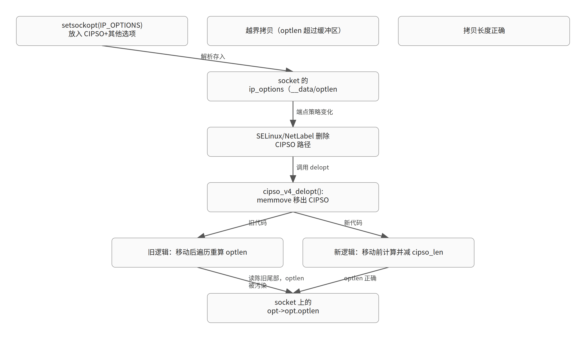

# cipso_v4_delopt() 移出 CIPSO 后重算 optlen 读到陈旧尾部字节：长度污染与越界拷贝

> 生成于 2026-10-30T02:49:48Z｜补丁深读｜模型 glm-5.3｜内核 commit 89a312991dc6｜证据 4 份（一手 4 / 二手 0）

对应日报：`digest/2026-10-29.md`

原文：[[PATCH net v4] cipso: fix optlen corruption in cipso_v4_delopt()](https://lore.kernel.org/all/20261029033942.3644-1-q.h.hack.winter@gmail.com/)

## TL;DR

- cipso_v4_delopt() 先用 memmove 把 CIPSO 选项移出缓冲区，再遍历缓冲区重算长度，会把尾部残留的陈旧字节当成选项数据，使 opt->opt.optlen 超出有效选项范围。
- 被污染的 optlen 留在 socket 上，随后被 getsockopt(IP_OPTIONS) 和 udp/raw/ping 的 sendmsg 路径当作拷贝长度使用，超出其拷入缓冲区的大小。
- 修复改为在 memmove 之前基于完整选项计算新长度并减去 CIPSO 长度，同时用 IPOPT_END 填充填充区；该 v4 为首次公开张贴，已获 Paul Moore 的 Acked-by。

## 先修知识

*以下为理解本文所需的背景知识，属模型补充；带源码锚点的请自行核对。*

### CIPSO 选项

- **是什么**：IPv4 头部选项（类型 IPOPT_CIPSO）中携带安全标签的机制，内核中由 net/ipv4/cipso_ipv4.c 实现，供 NetLabel/SELinux 给打出的包贴标签
- **为什么这里需要**：不理解 CIPSO 是 socket IP 选项缓冲区中的一个普通选项，就无法理解为什么删除它需要 memmove 搬移后续字节、以及为什么会留下陈旧尾部
- **在本文中的位置**：cipso_v4_delopt() 中通过 opt->opt.cipso 偏移定位 CIPSO 选项，cipso_len = cipso_ptr[1] 取其长度字节（`net/ipv4/cipso_ipv4.c:1995`）
- **一个例子**：一个 socket 的 IP 选项缓冲区里可以同时存在 RR/TS 等选项和一个 CIPSO 选项，删除 CIPSO 时其余选项要前移补位

### struct ip_options（socket 上的 IP 选项）

- **是什么**：socket 关联的 IP 选项容器：__data[] 存原始选项字节，optlen 存总长，srr/rr/ts/cipso 等字段存各选项在缓冲区中的偏移
- **为什么这里需要**：本 bug 的核心就是 opt->opt.optlen 这个长度字段被写坏并长期留在 socket 上；偏移字段的调整（srr -= cipso_len 等）也发生在同一结构上
- **在本文中的位置**：cipso_v4_delopt() 中对 opt->opt.srr/rr/ts/cipso/optlen/__data 的全部读写（`net/ipv4/cipso_ipv4.c:2013`）
- **一个例子**：用户 setsockopt(IP_OPTIONS) 设置的选项经解析后存入该结构；getsockopt(IP_OPTIONS) 再按 optlen 拷回用户态

### cipso_v4_get_actual_opt_len()

- **是什么**：遍历选项缓冲区、按每个选项的长度字节累加，得到实际有效选项长度的辅助函数
- **为什么这里需要**：旧代码在 memmove 之后调用它重算长度，遍历会越过有效数据进入尾部陈旧字节；新代码把它挪到 memmove 之前调用
- **在本文中的位置**：补丁 diff 中两处调用：旧位置在 memmove 之后（被删除），新位置在 memmove 之前（`net/ipv4/cipso_ipv4.c:2016`）
- **一个例子**：若尾部残留字节的某个值被当作选项长度，累加结果可超过真实有效长度

### IPOPT_END / IPOPT_NOOP 填充语义

- **是什么**：IPOPT_END 表示选项列表结束，IPOPT_NOOP 是 1 字节占位；选项解析循环遇到 IPOPT_END 即停止
- **为什么这里需要**：IP 选项按 4 字节对齐，不足处需填充；修复用 IPOPT_END（值 0）填充 memmove 后腾出的区域，保证后续任何遍历都不会把填充区当选项数据
- **在本文中的位置**：补丁新增的 memset(&opt->opt.__data[optlen_new], IPOPT_END, ...)；解析循环示例见 cipso_v4_optptr() 的 switch（`net/ipv4/cipso_ipv4.c:1502`）
- **一个例子**：cipso_v4_optptr() 中 case IPOPT_END: return NULL，说明解析器信任 END 终止符

### NetLabel/SELinux 的 CIPSO 设置与删除路径

- **是什么**：SELinux 通过 NetLabel 框架在连接端点变化时给 socket 设置或删除 CIPSO 标签，对应 cipso_v4_sock_setattr()/cipso_v4_sock_delattr() 等接口
- **为什么这里需要**：本 bug 的触发前提是 socket 上先有 CIPSO 选项，之后某个删除路径调用 cipso_v4_delopt()；Fixes 指向的 SELinux 提交正是让该路径更易到达的改动
- **在本文中的位置**：include/net/cipso_ipv4.h 中声明的 cipso_v4_sock_setattr/cipso_v4_sock_delattr；补丁 Fixes: 014ab19a69c32（`include/net/cipso_ipv4.h:184`）
- **一个例子**：用户先用 setsockopt(IP_OPTIONS) 放入 CIPSO+其他选项，随后 SELinux 端点策略变化触发删除 CIPSO（具体调用链未在材料中核实）

## 机制速览



### 图 1：触发链与新旧修复路径（教学简化示意）

### 表 1：旧逻辑与新逻辑的执行顺序对比

*关键差异是长度计算的时机从 memmove 之后提前到之前（教学简化示意）*

| 步骤 | 旧逻辑 | 新逻辑 |
|---|---|---|
| 1. 定位 CIPSO | 取 cipso_off/cipso_len | 取 cipso_off/cipso_len |
| 2. 计算新长度 | （无） | 对完整缓冲区 get_actual_opt_len，再减 cipso_len |
| 3. 调整偏移并 memmove | srr/rr/ts 偏移前移，memmove 搬移后续字节 | 同左 |
| 4. 重算长度 | memmove 后遍历缓冲区（读到陈旧尾部） | （已删除，不再重算） |
| 5. 对齐与填充 | optlen 4 字节对齐，填充区为陈旧字节 | optlen 对齐后 memset IPOPT_END 填充 |

### 表 2：memmove 前后缓冲区布局示意（教学简化）

*陈旧字节 = memmove 前位于 CIPSO 之后区域、搬移后残留在尾部的旧数据（教学简化示意）*

| 阶段 | 缓冲区内容 | optlen 状态 |
|---|---|---|
| 删除前 | [其他选项][CIPSO][尾部填充] | 等于有效选项长度 |
| memmove 后（修复前） | [其他选项][陈旧字节……] | 仍为旧值，待重算 |
| 旧代码重算 | 遍历进入陈旧区，某字节被当选项长度 | optlen 可超过有效数据 |
| 新代码 | [其他选项][IPOPT_END 填充] | 移动前算好，正确且对齐 |

## 背景：这段代码为什么存在

【背景补充，需核对】 **结论**：socket 上的 IPv4 选项存放在 ip_options_rcu 的连续缓冲区里，删除其中一个选项需要 memmove 搬移后续字节并重算总长，这正是本 bug 的舞台。

- CIPSO 是 IPv4 选项中携带安全标签的机制，由 NetLabel/SELinux 使用；socket 的 IP 选项（可由 setsockopt(IP_OPTIONS) 设置）解析后存入 struct ip_options：__data[] 存原始字节，optlen 存总长，srr/rr/ts/cipso 存各选项偏移。
- cipso_v4_delopt() 负责从一组 IP 选项中删除 CIPSO 选项：若缓冲区里还有其他选项（srr/rr/ts/router_alert 非零），它先按 cipso_len 调整后续选项的偏移字段，再 memmove 把 CIPSO 之后的字节前移，最后重算 optlen 并 4 字节对齐；若只有 CIPSO，则整个释放选项结构。
- 旧代码重算长度的方式是在 memmove 之后调用 cipso_v4_get_actual_opt_len() 遍历缓冲区累加各选项长度——这个'先搬移、后测量'的顺序是问题根源。
- IP 选项必须 4 字节对齐，尾部需要填充；IPOPT_END（值 0）是标准的结束标志，解析循环（如 cipso_v4_optptr()）遇到它会停止遍历。

## Bug 与触发条件

【材料陈述】 **结论**：memmove 移出 CIPSO 后，缓冲区尾部留下未被清理的陈旧字节，随后的长度遍历把它们当作选项数据，攻击者可用精心构造的 setsockopt(IP_OPTIONS) 缓冲区把 optlen 顶到有效数据之外。 [材料 1](https://lore.kernel.org/all/20261029033942.3644-1-q.h.hack.winter@gmail.com/raw)

- 触发前提分两步：一是用户通过 setsockopt(IP_OPTIONS) 在 socket 上放入包含 CIPSO 在内的多个选项；二是之后某个 NetLabel/SELinux 删除路径调用 cipso_v4_delopt() 移除 CIPSO（从 SELinux 到 delopt 的具体调用链未在材料中给出，可达路径未核实）。
- memmove 把 CIPSO 之后的字节前移后，缓冲区尾部 cipso_len 个字节是搬移前留下的陈旧数据；旧代码此时才调用 cipso_v4_get_actual_opt_len(opt->opt.__data, opt->opt.optlen) 遍历，遍历范围仍是旧的 optlen，于是把陈旧尾部当作选项解析。
- commit message 明确指出：精心构造的 setsockopt(IP_OPTIONS) 缓冲区可使遍历把某个陈旧字节当作选项长度，使 opt->opt.optlen 增大到超出有效选项数据。
- 被污染的长度持久留在 socket 上，后续被 getsockopt(IP_OPTIONS) 和 udp/raw/ping 的 sendmsg 路径用作拷贝长度，且超过它们拷入缓冲区的大小——即越界拷贝；材料未说明该越界的具体后果（如是否可升级为内存破坏）。

## 讨论与版本过程

【材料陈述】 **结论**：v4 是首次公开张贴（v1-v3 私下评审、内容不可核实），公开后只收到两个 bot 的自动意见和 maintainer Paul Moore 的 Acked-by，尚无人类技术评审意见。 [材料 1](https://lore.kernel.org/all/20261029033942.3644-1-q.h.hack.winter@gmail.com/raw) [材料 4](https://lore.kernel.org/all/CAHC9VhRQ8E7zysipt3Kt44oC9m-eUc78mR5ipR3YQOwuBXAV5g@mail.gmail.com/raw)

**讨论时间线**

- **v1-v3 私下评审** · Qihang（作者）：作者自述 v1-v3 经过私下评审，具体内容、评审人和结论均未公开 → 不可核实 [材料 1](https://lore.kernel.org/all/20261029033942.3644-1-q.h.hack.winter@gmail.com/raw)
- **v4 首次公开张贴** · Qihang（作者）：rebase 到 net（fcc00b15cb21a），仅重写影响描述段落、无功能变化；发到 netdev 并抄送 Paul Moore、LSM 列表和 Lucas Dupré--Rabinovici → 进入公开评审 [材料 1](https://lore.kernel.org/all/20261029033942.3644-1-q.h.hack.winter@gmail.com/raw)
- **netdev 自动检查** · netdev-bot（自动检查）：bot（LLM 评估）指出 commit message 缺少问题发现方式（生产/开发/syzbot/人工审查/LLM 或静态分析）以及是否实际触发过、症状如何；要求回复邮件补充而非重发 → 材料中未见作者回复 [材料 2](https://lore.kernel.org/all/179324557093.3327.5514860593383240428@kernel.org/raw)
- **Sashiko AI 评审** · sashiko-bot（自动检查）：AI 评审 bot 复述 commit message 后报告'未发现问题' → 无实质技术意见 [材料 3](https://lore.kernel.org/all/sashiko-outbox-188686@kernel.org/raw)
- **maintainer 回复** · Paul Moore（维护者）：SELinux/LSM maintainer 回复 Thanks 并给出 Acked-by，未展开技术讨论 → 获得 Acked-by；合入状态未核实 [材料 4](https://lore.kernel.org/all/CAHC9VhRQ8E7zysipt3Kt44oC9m-eUc78mR5ipR3YQOwuBXAV5g@mail.gmail.com/raw)

## 补丁改动

【材料陈述】 **结论**：修复只改 cipso_v4_delopt() 一个函数：把长度计算挪到 memmove 之前基于完整选项完成并直接减去 cipso_len，再用 IPOPT_END 填充对齐产生的填充区。 [材料 1](https://lore.kernel.org/all/20261029033942.3644-1-q.h.hack.winter@gmail.com/raw)

- 新增四行：在调整 srr/rr/ts 偏移之前，先对尚未搬移的完整缓冲区调用 cipso_v4_get_actual_opt_len(opt->opt.__data, opt->opt.optlen) 得到 optlen_new，再减去 cipso_len——此时缓冲区内容完整，遍历不会读到陈旧字节。
- 删除 memmove 之后旧的重算调用（原 optlen_new = cipso_v4_get_actual_opt_len(...) 两行），保留 hdr_delta/optlen 对齐逻辑：opt->opt.optlen = (optlen_new + 3) & ~3。
- 新增 memset(&opt->opt.__data[optlen_new], IPOPT_END, opt->opt.optlen - optlen_new)，把 4 字节对齐产生的填充区显式清为 IPOPT_END，消除任何后续遍历读到未定义字节的可能。
- 补丁共 1 文件、+7/-2 行，带 Fixes: 014ab19a69c32（"selinux: Set socket NetLabel based on connection endpoint"）和 Cc: stable@vger.kernel.org，标注 Assisted-by: LLM。

## 为什么有效与边界

【教学推演】 **结论**：修复的有效性来自'测量先于搬移'这一不变量：在缓冲区仍然完整时计算长度，天然不会读到陈旧字节；填充 IPOPT_END 则封死了同类问题的另一条入口。

- 正确性：memmove 之前 __data 中 CIPSO 及其前后选项都处于解析器认可的有效布局，cipso_v4_get_actual_opt_len 遍历的是真实选项；减去 cipso_len 在数学上等价于'删除 CIPSO 后的实际长度'，且不依赖对尾部字节的任何假设。
- 为什么还要 memset IPOPT_END：optlen_new 到 4 字节对齐的 optlen 之间有填充区，memmove 后那里是陈旧字节；虽然新逻辑不再遍历它，但 socket 上的选项缓冲区可能被其他代码路径再次解析，显式填 END 让缓冲区在任何观察者眼中都是自洽的。
- 代价与边界：多一次对完整缓冲区的遍历（原本也要遍历一次，只是位置提前），开销不变；改动局限在'还有其他选项'的分支，'只有 CIPSO 则整体释放'的分支不受影响。
- 残存风险：修复只保证 delopt 自身不再污染 optlen；若历史上已有 socket 携带被污染的 optlen，本补丁不会修复它们（需重建 socket）。另外 hdr_delta 的计算依赖新旧 optlen 差值，材料中未展示其全部用途，相关调用方行为未逐一核实。

## 可迁移结论

【教学推演】 **结论**：这类'搬移缓冲区内容后再重新解析'的模式是长度字段的经典污染源，审查时应把'测量时机'当作一等公民检查。

- 检查清单 1：任何 memmove/删除操作后重新遍历缓冲区的代码，问一句'遍历范围内的每个字节现在都代表有效数据吗'——搬移留下的尾部陈旧字节是最常见的盲区。
- 检查清单 2：长度字段（optlen 等）一旦被写坏会随对象长期存活，要顺着它的所有消费者（getsockopt、各 sendmsg 路径）追一遍拷贝长度与目标缓冲区大小的关系，评估是信息泄露还是越界写。
- 检查清单 3：结构变长/对齐产生的填充区要么显式清零/填 END，要么证明没有任何路径会解析它；'没人读'是最容易失效的假设。
- 检查清单 4：读内核补丁时注意 Fixes 标签指向的'引入提交'——它往往揭示了新的可达路径（本例是 SELinux 基于连接端点设置 NetLabel），比 bug 本身更能说明触发条件；同时 Acked-by 只代表认可，不等于已合入。

## 术语速查

*以下术语解释属于背景补充，需核对。*

| 术语 | 一句话解释 |
|---|---|
| optlen | struct ip_options 中的选项总长度字段，按 4 字节对齐；本 bug 中它被写坏并长期留在 socket 上 |
| hdr_delta | cipso_v4_delopt() 中记录删除 CIPSO 前后 optlen 差值的局部变量，用于通知调用方头部长度变化 |
| Fixes: 标签 | commit message 中指明引入 bug 的历史提交，配合 Cc: stable 触发稳定分支自动回溯 |
| Acked-by | 维护者表示认可的签名标签；只代表认可，不等于 Reviewed-by 级别的逐行评审，也不代表已合入 |

## 源码与关键逻辑

### 源码 1：net/ipv4/cipso_ipv4.c:1979-2019（commit 89a312991dc6）

```c
static int cipso_v4_delopt(struct ip_options_rcu __rcu **opt_ptr)
{
	struct ip_options_rcu *opt = rcu_dereference_protected(*opt_ptr, 1);
	int hdr_delta = 0;

	if (!opt || opt->opt.cipso == 0)
		return 0;
	if (opt->opt.srr || opt->opt.rr || opt->opt.ts || opt->opt.router_alert) {
		u8 cipso_len;
		u8 cipso_off;
		unsigned char *cipso_ptr;
		int optlen_new;

		cipso_off = opt->opt.cipso - sizeof(struct iphdr);
		cipso_ptr = &opt->opt.__data[cipso_off];
		cipso_len = cipso_ptr[1];

		if (opt->opt.srr > opt->opt.cipso)
			opt->opt.srr -= cipso_len;
		if (opt->opt.rr > opt->opt.cipso)
			opt->opt.rr -= cipso_len;
```

补丁前的 cipso_v4_delopt() 开头：只有当 socket 上还有其他选项（srr/rr/ts/router_alert 非零）时才走 memmove 分支；cipso_len 取自 CIPSO 选项的第二个字节（长度字段）。此分支正是 bug 所在。

### 源码 2：net/ipv4/cipso_ipv4.c（材料 1）

```c
diff --git a/net/ipv4/cipso_ipv4.c b/net/ipv4/cipso_ipv4.c
index 1aacbbeffbc64..e65a3f29d2caf 100644
--- a/net/ipv4/cipso_ipv4.c
+++ b/net/ipv4/cipso_ipv4.c
@@ -2013,6 +2013,10 @@ static int cipso_v4_delopt(struct ip_options_rcu __rcu **opt_ptr)
 		cipso_ptr = &opt->opt.__data[cipso_off];
 		cipso_len = cipso_ptr[1];
 
+		optlen_new = cipso_v4_get_actual_opt_len(opt->opt.__data,
+							 opt->opt.optlen);
+		optlen_new -= cipso_len;
+
 		if (opt->opt.srr > opt->opt.cipso)
 			opt->opt.srr -= cipso_len;
 		if (opt->opt.rr > opt->opt.cipso)
@@ -2026,11 +2030,12 @@ static int cipso_v4_delopt(struct ip_options_rcu __rcu **opt_ptr)
 		memmove(cipso_ptr, cipso_ptr + cipso_len,
 			opt->opt.optlen - cipso_off - cipso_len);
 
-		optlen_new = cipso_v4_get_actual_opt_len(opt->opt.__data,
-							 opt->opt.optlen);
 		hdr_delta = opt->opt.optlen;
 		opt->opt.optlen = (optlen_new + 3) & ~3;
 		hdr_delta -= opt->opt.optlen;
+
+		memset(&opt->opt.__data[optlen_new], IPOPT_END,
+		       opt->opt.optlen - optlen_new);
 	} else {
 		/* only the cipso option was present on the socket so we can
 		 * remove the entire option struct */

base-commit: fcc00b15cb21a6de76826e5012b2c758505f5e65
-- 
2.54.0 (Apple Git-157)
```

补丁正文片段，来自本次抓取材料。

## 未核实项与材料限制

- v1-v3 为私下评审，具体内容、参与者和结论不可核实。
- 从 SELinux/NetLabel 到 cipso_v4_delopt() 的具体调用链（哪个函数在什么条件下触发删除）未在材料中给出，可达路径未核实。
- 问题是被实际触发还是纯代码审查发现：netdev-bot 明确询问，材料中未见作者回复。
- 越界拷贝的具体安全后果（信息泄露/内存破坏、是否可利用）材料未说明。
- 补丁是否已合入 net/主线未核实；Acked-by 不等于合入。
- hdr_delta 的全部用途及其调用方对长度变化的处理未在材料中展示。

## 材料

1. [一手材料] https://lore.kernel.org/all/20261029033942.3644-1-q.h.hack.winter@gmail.com/raw
   > The walk then reads the stale bytes at the tail of the buffer as option data, and a crafted setsockopt(IP_OPTIONS) buffer can make it treat one of them as an option length, increasing opt->opt.optlen beyond the valid option data.
   > The corrupted length stays on the socket and is later used as the copy length by getsockopt(IP_OPTIONS) and by the udp/raw/ping sendmsg paths, where it exceeds the size of the buffers they copy into.
   > v4:  - rebased onto net (fcc00b15cb21a)  - reworded the impact paragraph only, no functional change  - first public posting (v1-v3 were reviewed privately)
2. [一手材料] https://lore.kernel.org/all/179324557093.3327.5514860593383240428@kernel.org/raw
   > How the issue was discovered, e.g. hit in production, hit during development, syzbot report, manual code inspection, LLM or static analysis tool scan.
3. [一手材料] https://lore.kernel.org/all/sashiko-outbox-188686@kernel.org/raw
   > Sashiko has reviewed this patch and found no issues.
4. [一手材料] https://lore.kernel.org/all/CAHC9VhRQ8E7zysipt3Kt44oC9m-eUc78mR5ipR3YQOwuBXAV5g@mail.gmail.com/raw
   > Thanks!  Acked-by: Paul Moore <paul@paul-moore.com>
