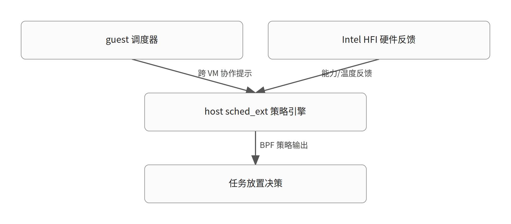

# sched_ext 微会议三大议题：优先级反转、半虚拟化调度与拓扑感知调度

> 生成于 2026-10-29T11:57:14Z｜模型 glm-5.3｜内核 commit 89a312991dc6e638a36adc43ccb91dbc25504c04｜证据 1 份（一手 0 / 二手 1）

对应日报：`digest/2026-10-29.md`

原文：[A report from the LPC sched_ext microconference](https://lwn.net/Articles/1103426/)

## 1. 必要背景与旧机制

【背景补充，需核对】 sched_ext 是内核中的 BPF 可编程调度器类，由 CONFIG_SCHED_CLASS_EXT 控制，头文件 include/linux/sched/ext.h 的注释自述为 "BPF extensible scheduler class"。它把任务入队、CPU 选择、时间片管理等决策点暴露给 BPF 程序，使调度策略可以在不修改内核主体代码的情况下加载和替换；默认时间片等公共常量（如 SCX_SLICE_DFL）就定义在该头文件中，tools/sched_ext/ 下还带有 scx_simple 等示例调度器。据 LWN 报道，Linux Plumbers Conference 在布拉格举行了 sched_ext 微会议，讨论集中在三个主题上：优先级反转的处理、半虚拟化调度、以及设备与拓扑感知调度。本段为背景补充，具体版本合入时间线等细节需读者自行核对。（背景补充，需核对） [材料 1]

## 2. 问题与触发场景

【事实】 这份 LPC 微会议报告把 sched_ext 当前面临的三个待解问题列为讨论焦点。第一是优先级反转（priority inversion）在 sched_ext 下的处理：报告明确列出的子议题包括 lock holder 与 lock waiter 的抢占、时间片延长（time slice extension），以及让 proxy execution 机制与 BPF 调度器协同工作。第二是半虚拟化调度：如何让 host 与 guest 两级调度器跨越虚拟机边界协作，由 host 侧的 sched_ext 充当策略引擎。第三是设备与拓扑感知调度：如何利用硬件反馈（Intel HFI）、设备与加速器的局部性、以及 cache 拓扑信息来驱动任务放置决策。需要强调的是，该材料是一份简短的会议纪要式报道，只列出了议题清单，没有给出每个议题的具体技术方案、与会者结论或是否形成了补丁与合入计划，这些细节在材料中均未提及。 [材料 1] [材料 1]

## 3. 本次改动

【事实】 报告给出的讨论方向对应三个议题。其一，优先级反转方向上，会议讨论了 lock holder 和 lock waiter 抢占、时间片延长，以及让 proxy execution 与 BPF 调度器一起工作——也就是说，当低优先级任务持有锁、高优先级任务等待时，sched_ext 需要机制层面的支持，而不是仅靠策略侧自行绕过。其二，半虚拟化调度方向上，思路是让 host 与 guest 调度器跨 VM 边界合作，sched_ext 在 host 上作为策略引擎，即 guest 侧提供信息或提示，最终放置决策由 host 上的 BPF 调度器做出。其三，设备与拓扑感知调度方向上，讨论了用 Intel HFI 硬件反馈、设备/加速器局部性和 cache 拓扑来驱动任务放置，让调度决策感知到硬件的实际能力与互连距离。注意：以上是报告明确列出的讨论内容；至于每个方向讨论到了什么深度、是否达成共识，材料没有说明，不应过度解读。 [材料 1] [材料 1]

## 4. 为什么有效

【教学推演】 为什么恰好是这三个议题成为焦点，可以从 sched_ext 的架构推演（教学推演，非材料结论）。优先级反转是可编程调度器的结构性难题：BPF 调度器看到的是任务和 DSQ，看不到任务在内核中持有哪些锁；若持锁任务被抢占，等待者被无限拉长。经典解法有三条路——抢占 lock waiter（让等待者优先跑以尽快拿到锁）、延长 lock holder 的时间片让它把临界区跑完、或用 proxy execution 让等待者"代理"执行持锁者——报告列出的三个子议题正好一一对应这三条路，说明讨论是在系统性地梳理解空间。时间片延长在 sched_ext 中有现成的机制抓手：include/linux/sched/ext.h 定义了 SCX_SLICE_DFL（20ms）、SCX_SLICE_BYPASS（5ms）和 SCX_SLICE_INF（无限、隐含 nohz），策略侧可以按任务动态设置 slice。半虚拟化调度则源于两级调度的信息不对称：guest 调度器不知道 host 的 CPU 状态，host 也不知道 guest 内的优先级；让 host 上的 sched_ext 做策略引擎，等于把最终决策权放在能看到真实硬件的一侧。拓扑感知方向上，Intel HFI 在 drivers/thermal/intel/intel_hfi.c 中已有事件通路（thermal 中断触发 intel_hfi_process_event，经 delayed work 更新能力表），讨论的应是让这类反馈流入调度决策。

## 5. 代价、边界与未决问题

【教学推演】 从教学角度推演这些方向的代价与权衡（教学推演）。时间片延长是吞吐与尾延迟的交换：给 lock holder 更长的 slice 能减少上下文切换和锁传递开销，但会推迟同 CPU 上其他任务的运行，对交互式负载不友好；sched_ext 的优势是策略可以按任务、按锁深度动态决定，而不是全局一刀切。proxy execution 与 BPF 调度器协同的难点在于语义复杂：等待者代替持锁者运行会模糊"谁在消耗 CPU"的记账，BPF 策略需要理解这种代理关系才能正确计算 vtime 与公平性。半虚拟化调度的代价在信任与开销：guest 提供的提示可能自私或不准确，host 必须把 hint 当建议而非指令；跨 VM 边界传递信息本身也有延迟和迁移成本，且 guest 内核版本各异，接口需要向后兼容。拓扑感知调度的风险是反馈滞后与粒度：HFI 类硬件反馈是温度/性能的间接信号，采样有延迟，若调度器对噪声过度反应，任务会在核间来回弹跳，反而损害 cache 局部性——这正是它想优化的目标。以上权衡均为推演，会议现场是否讨论到这些层面，材料未记载。 [材料 1]

## 6. 可迁移结论

【教学推演】 这份微会议报告的价值不在于给出了答案，而在于标出了 sched_ext 从"能跑"走向"好用"要翻越的三座山：正确性（优先级反转——可编程调度器必须与内核锁语义共存）、边界（半虚拟化——调度策略的管辖权止于 VM 边界，需要新的协作协议）、以及硬件现实（拓扑感知——调度决策应消费 HFI 这类真实反馈而非静态拓扑表）。对内核学习者而言，这是一个很好的观察窗口：sched_ext 把策略从内核里搬到了 BPF，但策略搬出去之后，原来 CFS/EEVDF 在内核内隐式获得的东西（锁感知、虚拟化协作、硬件反馈通路）都需要重新设计接口。跟踪这三个议题的后续补丁，比读任何一篇综述都更能理解"调度器类"这个抽象层的真实边界。（教学推演）

## 图示

### 图 1：半虚拟化调度与拓扑感知：host 侧 sched_ext 作为策略引擎（教学简化示意）



图示文字路径：

- guest 调度器 → 跨 VM 协作提示 → host sched_ext 策略引擎
- Intel HFI 硬件反馈 → 能力/温度反馈 → host sched_ext 策略引擎
- host sched_ext 策略引擎 → BPF 策略输出 → 任务放置决策

## 源码与关键逻辑

### 源码 1：drivers/thermal/intel/intel_hfi.c:234-274（commit 89a312991dc6）

```c
static void hfi_update_work_fn(struct work_struct *work)
{
	struct hfi_instance *hfi_instance;

	hfi_instance = container_of(to_delayed_work(work), struct hfi_instance,
				    update_work);

	update_capabilities(hfi_instance);
}

void intel_hfi_process_event(__u64 pkg_therm_status_msr_val)
{
	struct hfi_instance *hfi_instance;
	int cpu = smp_processor_id();
	struct hfi_cpu_info *info;
	u64 new_timestamp, msr, hfi;

	if (!pkg_therm_status_msr_val)
		return;

	info = &per_cpu(hfi_cpu_info, cpu);
	if (!info)
		return;

	/*
	 * A CPU is linked to its HFI instance before the thermal vector in the
	 * local APIC is unmasked. Hence, info->hfi_instance cannot be NULL
	 * when receiving an HFI event.
	 */
	hfi_instance = info->hfi_instance;
```

Intel HFI（Hardware Feedback Interface）的现有事件处理路径：thermal 中断触发 intel_hfi_process_event，经 delayed work 调用 update_capabilities 更新各 CPU 的能力表。会议讨论的"硬件反馈驱动调度"即指让 sched_ext 策略消费这类信息。这是现有代码，非本次会议改动。

### 源码 2：tools/sched_ext/scx_simple.bpf.c:40-80（commit 89a312991dc6）

```c
s32 BPF_STRUCT_OPS(simple_select_cpu, struct task_struct *p, s32 prev_cpu, u64 wake_flags)
{
	bool is_idle = false;
	s32 cpu;

	cpu = scx_bpf_select_cpu_dfl(p, prev_cpu, wake_flags, &is_idle);
	if (is_idle) {
		stat_inc(0);	/* count local queueing */
		scx_bpf_dsq_insert(p, SCX_DSQ_LOCAL, SCX_SLICE_DFL, 0);
	}

	return cpu;
}

void BPF_STRUCT_OPS(simple_enqueue, struct task_struct *p, u64 enq_flags)
{
	stat_inc(1);	/* count global queueing */

	if (fifo_sched) {
		scx_bpf_dsq_insert(p, SHARED_DSQ, SCX_SLICE_DFL, enq_flags);
```

scx_simple 示例调度器：BPF 侧通过 BPF_STRUCT_OPS 实现 select_cpu/enqueue 回调，用 scx_bpf_dsq_insert 指定 slice。会议讨论的拓扑感知调度、时间片延长等议题，最终都会落到扩展这类回调可见的信息与可设的参数上。这是现有示例代码，非本次会议改动。

## 未核实项与材料限制

- 未获取一手材料；以下只解释报道明确描述的思路。
- 材料仅为简短会议纪要，未记载任何议题的具体技术方案、讨论细节或与会者分歧
- 会议是否产生了补丁、RFC 或达成合入共识，材料未提及，本文不声称任何合入状态
- 报告发布日期标注为 2026 年 10 月 28 日，该日期本身来自材料，未另行核实
- proxy execution 与 BPF 调度器协同的具体设计（如代理执行的记账方式）在材料中完全没有展开，相关分析均为教学推演
- 半虚拟化调度中 guest 向 host 传递信息的具体接口（是否复用现有 KVM pv 接口）材料未提及
- 引用的三段内核代码是现有代码快照，用于背景讲解，与本次会议讨论的任何潜在改动无关
- 源码片段未通过核对，已省略：source 代码未在一手材料中找到

## 材料

1. [二手报道] https://lwn.net/Articles/1103426/
   > The Linux Plumbers Conference blog has a report from the sched_ext microconference held in Prague.
   > Three main topics dominated the discussions
   > Priority inversion and how to handle it in sched_ext: lock holder and lock waiter preemption, time slice extension, and making proxy execution work together with BPF schedulers.
