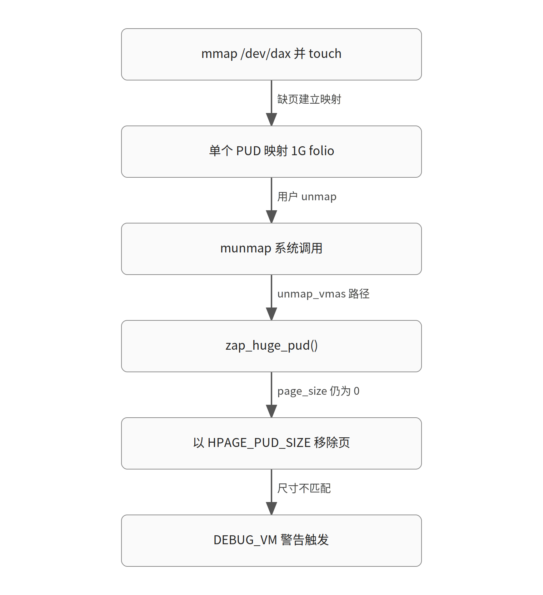

# zap_huge_pud() 漏设 mmu_gather page size：device-dax 1G munmap 在 powerpc 上触发 DEBUG_VM 警告

> 生成于 2026-10-30T08:26:12Z｜补丁深读｜模型 glm-5.3｜内核 commit 89a312991dc6｜证据 6 份（一手 6 / 二手 0）

对应日报：`digest/2026-10-30.md`

原文：[[PATCHv2] mm/huge_memory: set the mmu_gather page size in zap_huge_pud()](https://lore.kernel.org/all/8b853e5f9f16145859407b28af654b0f79e12642.1793318297.git.ritesh.list@gmail.com/)

## TL;DR

- powerpc radix 内核开 CONFIG_DEBUG_VM 后，munmap 一个 1G 对齐的 device-dax 映射会在 __tlb_remove_folio_pages_size() 每次都触发 VM_WARN_ON 警告。
- 根因：dbe54153296d 让 device-dax PUD 映射真实 folio，zap_huge_pud() 以 HPAGE_PUD_SIZE 移除页，却从未调用 tlb_change_page_size() 设置 tlb->page_size（munmap 新建 gather 时为 0）。
- 修复只加两行：在 zap_huge_pud() 取锁前 tlb_change_page_size(tlb, HPAGE_PUD_SIZE)，与 zap_huge_pmd() 等路径一致；已获 Zi Yan、Muchun Song 的 Acked-by 和 Power10 实测，尚无 maintainer 意见。

## 先修知识

*以下为理解本文所需的背景知识，属模型补充；带源码锚点的请自行核对。*

### mmu_gather 与 MMU_GATHER_PAGE_SIZE

- **是什么**：mmu_gather 在 unmap 过程中批量收集待 flush 的 TLB 项和待释放页；powerpc 等架构启用 CONFIG_MMU_GATHER_PAGE_SIZE 后，tlb->page_size 记录本次操作对应的页尺寸
- **为什么这里需要**：不理解它就看不懂警告从哪来：__tlb_remove_folio_pages_size() 里的 VM_WARN_ON(tlb->page_size != page_size) 只在该配置下才编译进去
- **在本文中的位置**：mm/mmu_gather.c 的 __tlb_remove_folio_pages_size()，即本次警告的检查点（`mm/mmu_gather.c:167`）
- **一个例子**：munmap 新建的 gather 其 page_size 为 0；若不先设置就以 HPAGE_PUD_SIZE 移除页，检查立即触发

### zap_huge_pud()

- **是什么**：munmap 路径上处理 PUD 级（本场景 1G）大映射的函数：清 PUD 项、记录 TLB entry、按 folio 释放页
- **为什么这里需要**：本次修复的直接落点，警告调用链的第一帧（LR 指向 zap_huge_pud+0x1b8）
- **在本文中的位置**：mm/huge_memory.c，由 __zap_vma_range() → unmap_vmas() 调用（`mm/huge_memory.c:3001`）
- **一个例子**：device-dax 映射 touch 首字节后整段 1G 由单个 PUD 覆盖，munmap 即进入此函数

### tlb_change_page_size()

- **是什么**：在以某个尺寸移除页之前，把该尺寸记录进 mmu_gather 的 helper；未启用 MMU_GATHER_PAGE_SIZE 的架构上是空操作
- **为什么这里需要**：修复就是补这一行调用；zap_huge_pmd()、zap_pte_range()、change_huge_pud() 等路径都有这一步，唯独 zap_huge_pud() 漏了
- **在本文中的位置**：madvise_free_huge_pmd() 中在取锁前调用 tlb_change_page_size(tlb, HPAGE_PMD_SIZE)，是现成的模式参照
- **一个例子**：反例：修复前 zap_huge_pud() 直接把页交给 tlb_remove_page_size(..., HPAGE_PUD_SIZE) 而未先设置 page_size

### device-dax 与 vmf_insert_folio_pud()

- **是什么**：/dev/dax* 设备可把设备内存直接映射进用户进程；dbe54153296d（"mm/huge_memory: add vmf_insert_folio_pud()"）之后，PUD 级 device-dax 映射背后是真实 folio
- **为什么这里需要**：正是该 commit 让 zap_huge_pud() 开始把页交给 tlb_remove_page_size()，从而暴露漏设 page_size 的问题，也是 Fixes 标签指向的 commit
- **在本文中的位置**：Fixes: dbe54153296d0，见补丁说明
- **一个例子**：mmap /dev/dax0.0 + touch 首字节 → 单个 PUD 映射 1G folio

## 机制速览



### 图 1：警告触发链与修复切断点（教学简化示意）

*按箭头顺序读：用户映射并触碰 device-dax 形成 1G PUD 映射，munmap 进入 zap_huge_pud() 后以 HPAGE_PUD_SIZE 移除页，但 gather 的 page_size 仍为 0，DEBUG_VM 检查触发；修复在移除前补设 page_size，切断最后一环。*

### 表 1：各路径设置 mmu_gather page size 对比

*前三行来自补丁说明的陈述；后两行为本补丁改动前后对照。（教学简化示意）*

| 路径 | 是否设置 page_size | 结果 |
|---|---|---|
| zap_huge_pmd() | 已设置 | 无警告 |
| zap_pte_range() | 已设置 | 无警告 |
| change_huge_pud() | 已设置 | 无警告 |
| zap_huge_pud()（修复前） | 未设置 | DEBUG_VM 下每次 munmap 警告 |
| zap_huge_pud()（修复后） | 设为 HPAGE_PUD_SIZE | 警告消除 |

## 背景：这段代码为什么存在

【背景补充，需核对】 **结论**：munmap 通过 mmu_gather 批量推迟 TLB flush 和页释放，powerpc 额外要求 gather 记录页尺寸，而 PUD 级大页的 zapping 由 zap_huge_pud() 负责。

- mmu_gather 机制：unmap 大范围地址时，内核把待释放页挂进 gather 的 batch，最后统一做 TLB flush 和释放，避免逐项 flush。powerpc 启用 CONFIG_MMU_GATHER_PAGE_SIZE，tlb->page_size 记录本次 flush 对应的页尺寸，供架构侧决定 flush 粒度。
- zap_huge_pud()（mm/huge_memory.c:3001）处理 PUD 级透明大页/大映射的 zapping：先 __pud_trans_huge_lock() 取锁，清 PUD 项，记录 TLB entry，再按 folio 释放页。它由 __zap_vma_range() → unmap_vmas() 在 munmap 路径上调用。
- device-dax 允许用户进程直接映射设备内存；dbe54153296d 引入 vmf_insert_folio_pud() 后，PUD 级 device-dax 映射背后是真实 folio，zapping 时需要把该 folio 交给 mmu_gather 释放——这是问题被引入的行为变化点。
- 内核中已有约定：任何以非 PAGE_SIZE 尺寸移除页的路径，都要先调用 tlb_change_page_size() 更新 gather 记录的尺寸；zap_huge_pmd()、zap_pte_range()、change_huge_pud() 都这么做（补丁说明中陈述）。

## Bug 与触发条件

【材料陈述】 **结论**：修复前 zap_huge_pud() 以 HPAGE_PUD_SIZE 移除页却从未设置 tlb->page_size，powerpc 的 DEBUG_VM 检查在每次 munmap 时必然触发。 [材料 3](https://lore.kernel.org/all/8b853e5f9f16145859407b28af654b0f79e12642.1793318297.git.ritesh.list@gmail.com/)

- 触发条件与复现：powerpc radix 内核 + CONFIG_DEBUG_VM，mmap /dev/dax0.0、touch 首字节使整个 1G 由单个 PUD 映射、再 munmap，每次都触发 WARNING: mm/mmu_gather.c:176 at __tlb_remove_folio_pages_size，调用链为 zap_huge_pud → __zap_vma_range → unmap_vmas → ... → sys_munmap。
- 机制：dbe54153296d 之后 device-dax PUD 映射真实 folio，zap_huge_pud() 把页交给 tlb_remove_page_size(tlb, page, HPAGE_PUD_SIZE)；此时 tlb->page_size 还是上一个使用者留下的值——munmap 新建的 gather 为 0——于是 __tlb_remove_folio_pages_size() 里的 VM_WARN_ON(tlb->page_size != page_size) 触发。
- 可达性与边界：该检查只在 CONFIG_MMU_GATHER_PAGE_SIZE（powerpc 启用）且 CONFIG_DEBUG_VM 下编译；其他架构上这段检查不存在，同样代码不会报警。触发还需要能建立 PUD 级（1G 对齐）的 device-dax 映射。
- 权限要求：本地用户对 /dev/dax 设备有映射权限即可触发；材料未讨论容器化或权限收紧场景下的可达性。
- 未核实边界：材料只演示了警告；非 DEBUG_VM 的 powerpc 构建下 page_size=0 是否造成实际错误的 TLB flush，材料没有证据，不能断言。

## 讨论与版本过程

【材料陈述】 **结论**：v1 是两补丁系列，patch-1 被 Muchun Song 的替代补丁取代后，作者拆分系列单独发 v2；本补丁本身 v1→v2 无变化，已获两位 reviewer 的 Ack 和 Power10 实测。 [材料 1](https://lore.kernel.org/all/97f85592bb78a273be8519e6897e7f9b9bd31469.1793070429.git.ritesh.list@gmail.com/) [材料 3](https://lore.kernel.org/all/8b853e5f9f16145859407b28af654b0f79e12642.1793318297.git.ritesh.list@gmail.com/)

**讨论时间线**

- **v1 两补丁系列（2026-10-27）** · Ritesh Harjani（作者）：v1 以 [PATCH 1/2]（powerpc radix vmemmap 不被已有 PMD leaf dedup）+ [PATCH 2/2]（本修复：zap_huge_pud 设置 mmu_gather page size）发出 → 进入公开评审 [材料 1](https://lore.kernel.org/all/97f85592bb78a273be8519e6897e7f9b9bd31469.1793070429.git.ritesh.list@gmail.com/)
- **v1 patch-1 收到回复（2026-10-27）** · Muchun Song（评审者）：线程索引显示 Muchun Song 当日回复了 patch-1；回复正文不在材料中，具体意见不可核实 → 围绕 vmemmap 修法展开讨论 [材料 1](https://lore.kernel.org/all/97f85592bb78a273be8519e6897e7f9b9bd31469.1793070429.git.ritesh.list@gmail.com/)
- **替代补丁（2026-10-29）** · Muchun Song（作者）：Muchun 另发补丁修同一 vmemmap 问题（复用已有 PMD 映射时把 section 标记为非 HVO），Closes 掉 v1 patch-1 线程；Ritesh 给出 Reviewed-by → 取代 v1 patch-1 [材料 2](https://lore.kernel.org/all/20261029063601.1961415-1-songmuchun@bytedance.com/)
- **v2 拆分重发（2026-10-30）** · Ritesh Harjani（作者）：拆分 2-part 系列：patch-1 被 Muchun 的补丁取代，本修复单独作为 v2 发出，内容与 v1 无差异 → 进入公开评审 [材料 3](https://lore.kernel.org/all/8b853e5f9f16145859407b28af654b0f79e12642.1793318297.git.ritesh.list@gmail.com/)
- **v2 评审：Zi Yan（2026-10-30）** · Zi Yan（评审者）：回复 "Makes sense. Thanks." 并给出 Acked-by → 获得 Ack [材料 4](https://lore.kernel.org/all/013E1BCB-AAEF-4F85-875E-B670739262A9@nvidia.com/)
- **v2 评审：Muchun Song（2026-10-30）** · Muchun Song（评审者）：给出 Acked-by → 获得 Ack [材料 5](https://lore.kernel.org/all/4012569A-93C1-4662-B6A3-3521B97B8C57@linux.dev/)
- **实测反馈（2026-10-30）** · Pavithra（参与者）：报告者在 Power10 (ppc64le)、kernel v7.3 上实测通过并给出 Tested-by → 修复验证通过 [材料 6](https://lore.kernel.org/all/7628b0e9814084298ae09abad0b5ac6f@linux.ibm.com/)

## 补丁改动

【材料陈述】 **结论**：修复是在 zap_huge_pud() 取锁之前加一行 tlb_change_page_size(tlb, HPAGE_PUD_SIZE)，与其他类似路径的做法完全一致。 [材料 3](https://lore.kernel.org/all/8b853e5f9f16145859407b28af654b0f79e12642.1793318297.git.ritesh.list@gmail.com/)

- diff 共 2 行插入，位于 __pud_trans_huge_lock() 之前：先把 gather 的 page_size 设为 HPAGE_PUD_SIZE，再取锁、清 PUD、移除 folio。
- 意图：在把 PUD 大页交给 tlb_remove_page_size(tlb, page, HPAGE_PUD_SIZE) 之前，让 tlb->page_size 与实际移除的页尺寸一致。
- 放置位置与现有模式一致：madvise_free_huge_pmd() 也是在 pmd_trans_huge_lock() 之前调用 tlb_change_page_size(tlb, HPAGE_PMD_SIZE)（mm/huge_memory.c:2368）。
- 作者明确说明修法来源："Fix this in the same way like how other similar paths do."

## 为什么有效与边界

【教学推演】 **结论**：补设 page_size 后 DEBUG_VM 检查通过，且 powerpc 的 flush 决策拿到正确页尺寸；该 bug 的实际后果需要区分"警告"与"潜在 flush 语义问题"。 [材料 3](https://lore.kernel.org/all/8b853e5f9f16145859407b28af654b0f79e12642.1793318297.git.ritesh.list@gmail.com/)

- 为什么有效：tlb_change_page_size 把 HPAGE_PUD_SIZE 写入 tlb->page_size，后续 __tlb_remove_folio_pages_size() 的 VM_WARN_ON(tlb->page_size != page_size) 不再触发；即使取锁失败提前 return 0，多设一次 page_size 也无害——其他路径同样在锁前设置。
- 后果分级（已证实）：CONFIG_DEBUG_VM 下的警告是诊断噪声，每次 munmap 都触发，干扰测试但本身不是内存破坏；材料未演示非 DEBUG_VM 构建下 page_size=0 导致错误 TLB flush、数据错误或可利用性问题，不能把"有警告"等同于"可利用"。
- 语义层面（教学推演，需核对）：powerpc 启用 MMU_GATHER_PAGE_SIZE 正是因为 flush 决策需要页尺寸；漏设意味着 gather 记录的尺寸与实际移除的 PUD 页不一致。修复消除的是这一语义不一致，而不只是让警告消失。
- 代价与边界：2 行改动、无性能代价；只覆盖 zap_huge_pud()，其他路径据补丁说明已设置。残存风险：未来新增"以非 PAGE_SIZE 尺寸移除页"的路径仍可能漏设，而该检查只在 powerpc + DEBUG_VM 下编译，其他架构测试发现不了。

## 可迁移结论

【教学推演】 **结论**：这是"新增大页移除路径时忘记配对 tlb_change_page_size()"的典型模式，可以提炼成可复用的检查清单。

- 配对检查：任何调用 tlb_remove_page_size()（或以非 PAGE_SIZE 尺寸向 mmu_gather 交页）的代码，必须先调用 tlb_change_page_size()；review 时可 grep 配对。
- 新增映射类型落地时（如 vmf_insert_folio_pud()），要审计对应的 zap/change/madvise 全部消费路径，而不只是 insert 路径——本次问题正是 insert 侧新功能让 zap 侧旧函数走到新分支。
- 只在特定架构+DEBUG 配置下编译的检查（CONFIG_MMU_GATHER_PAGE_SIZE + CONFIG_DEBUG_VM）能暴露通用代码里的架构相关遗漏；跨架构测试有实际价值。
- Fixes 标签应指向引入行为变化的 commit（dbe54153296d）而非最早引入函数的 commit，便于 stable 回溯定位受影响版本。

## 术语速查

*以下术语解释属于背景补充，需核对。*

| 术语 | 一句话解释 |
|---|---|
| HPAGE_PUD_SIZE | PUD 级大页尺寸；本场景中单个 PUD 覆盖 1G |
| device-dax | 通过 /dev/dax* 设备把设备内存直接映射进用户进程的机制 |
| VM_WARN_ON | 只打印警告不崩溃的内核断言，常受 DEBUG 配置控制 |
| radix | powerpc Book3S 64 的 Radix 页表 MMU 模式 |

## 源码与关键逻辑

### 源码 1：mm/huge_memory.c:3040-3048（材料 3）

```text
diff --git a/mm/huge_memory.c b/mm/huge_memory.c
index bd44d58e8684..7e589a2fb02d 100644
--- a/mm/huge_memory.c
+++ b/mm/huge_memory.c
@@ -3040,6 +3040,8 @@ int zap_huge_pud(struct mmu_gather *tlb, struct vm_area_struct *vma,
 	spinlock_t *ptl;
 	pud_t orig_pud;
 
+	tlb_change_page_size(tlb, HPAGE_PUD_SIZE);
+
 	ptl = __pud_trans_huge_lock(pud, vma);
 	if (!ptl)
 		return 0;
```

完整 diff：在 zap_huge_pud() 取锁之前，先把 mmu_gather 的 page_size 设为 HPAGE_PUD_SIZE，与后续 tlb_remove_page_size(tlb, page, HPAGE_PUD_SIZE) 的尺寸配对。

### 源码 2：mm/mmu_gather.c:166-179（commit 89a312991dc6）

```c
static bool __tlb_remove_folio_pages_size(struct mmu_gather *tlb,
		struct page *page, unsigned int nr_pages, bool delay_rmap,
		int page_size)
{
	int flags = delay_rmap ? ENCODED_PAGE_BIT_DELAY_RMAP : 0;
	struct mmu_gather_batch *batch;

	VM_BUG_ON(!tlb->end);

#ifdef CONFIG_MMU_GATHER_PAGE_SIZE
	VM_WARN_ON(tlb->page_size != page_size);
	VM_WARN_ON_ONCE(nr_pages != 1 && page_size != PAGE_SIZE);
	VM_WARN_ON_ONCE(page_folio(page) != page_folio(page + nr_pages - 1));
#endif
```

警告触发点：__tlb_remove_folio_pages_size() 在 CONFIG_MMU_GATHER_PAGE_SIZE 下比较 tlb->page_size 与传入的 page_size。修复前 zap_huge_pud() 传入 HPAGE_PUD_SIZE 而 tlb->page_size 为 0，VM_WARN_ON 即触发。

### 源码 3：mm/huge_memory.c:2358-2369（commit 89a312991dc6）

```c
bool madvise_free_huge_pmd(struct mmu_gather *tlb, struct vm_area_struct *vma,
		pmd_t *pmd, unsigned long addr, unsigned long next)
{
	spinlock_t *ptl;
	pmd_t orig_pmd;
	struct folio *folio;
	struct mm_struct *mm = tlb->mm;
	bool ret = false;

	tlb_change_page_size(tlb, HPAGE_PMD_SIZE);

	ptl = pmd_trans_huge_lock(pmd, vma);
```

现有模式参照：madvise_free_huge_pmd() 在取锁之前调用 tlb_change_page_size()。本补丁把同一模式补进 zap_huge_pud()。

## 未核实项与材料限制

- v1 patch-2 的原文不在材料中，仅凭 v2 说明"与 v1 无差异"得知内容相同。
- Muchun Song 2026-10-27 对 v1 patch-1 的回复正文不在材料中，具体意见不可核实。
- 非 DEBUG_VM 的 powerpc 构建下 page_size=0 是否导致实际错误的 TLB flush（而非仅无警告），材料没有证据。
- dbe54153296d 的具体改动内容仅来自补丁说明的描述，未见到该 commit 的 diff。
- 补丁合入状态未知；线程中没有 maintainer（Andrew Morton）的技术意见。

## 材料

1. [一手材料] https://lore.kernel.org/all/97f85592bb78a273be8519e6897e7f9b9bd31469.1793070429.git.ritesh.list@gmail.com/
   > mm/huge_memory: set the mmu_gather page size in zap_huge_pud()
   > [PATCH 1/2] powerpc/64s/radix: don't dedup vmemmap covered by an existing PMD leaf Muchun Song
2. [一手材料] https://lore.kernel.org/all/20261029063601.1961415-1-songmuchun@bytedance.com/
   > Reviewed-by: Ritesh Harjani (IBM) <ritesh.list@gmail.com>
3. [一手材料] https://lore.kernel.org/all/8b853e5f9f16145859407b28af654b0f79e12642.1793318297.git.ritesh.list@gmail.com/
   > Unmapping a device-dax mapping with 1G alignment on powerpc radix kernel
   > 0 for the fresh gather set up by munmap() and so the check fires.
   > a device-dax PUD maps a real folio and zap_huge_pud() now hands it to
4. [一手材料] https://lore.kernel.org/all/013E1BCB-AAEF-4F85-875E-B670739262A9@nvidia.com/
   > Acked-by: Zi Yan <ziy@nvidia.com>
5. [一手材料] https://lore.kernel.org/all/4012569A-93C1-4662-B6A3-3521B97B8C57@linux.dev/
   > Acked-by: Muchun Song <muchun.song@linux.dev>
6. [一手材料] https://lore.kernel.org/all/7628b0e9814084298ae09abad0b5ac6f@linux.ibm.com/
   > Tested on Power10 (ppc64le), kernel v7.3
