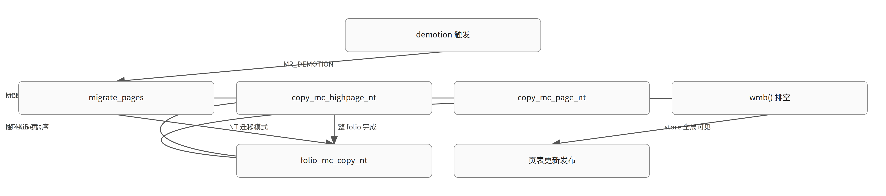

# 用非临时存储加速内存层级降级：copy_mc_page_nt、__HAVE_ARCH_COPY_PAGE_NT 与 MIGRATE_ASYNC_NONTEMPORAL

> 生成于 2026-11-04T05:23:46Z｜补丁深读｜模型 glm-5.3｜内核 commit 89a312991dc6｜证据 6 份（一手 6 / 二手 0）

对应日报：`digest/2026-11-04.md`

原文：[[RFC PATCH v3 0/3] mm: use non-temporal stores for demotion](https://lore.kernel.org/all/20261103223025.2482227-1-nhuhuan@google.com/)

## TL;DR

- 内存降级（DRAM→CXL/远端 NUMA）拷贝的是冷数据，普通 store 会因写分配把冷数据拉进本地 LLC，污染活跃工作集并增加设备读流量；v2 实测设备读流量从 N GB 降到接近 0。
- v3 由 Huan Nguyen 接手：x86 汇编实现 MCE 安全的 copy_mc_page_nt()（movnti + prefetchnta），用 __HAVE_ARCH_COPY_PAGE_NT 宏做架构抽象，并在 folio_mc_copy_nt() 末尾加 wmb() 排空弱序 NT store。
- 接口方向仍有争议：Johannes Weiner 等认为 migration reason 是比新增 migrate_mode 标志更强的信号，且本系列与 Shivank Garg 的 migrate_control 重构、批量页拷贝两个并行系列存在依赖，尚无 maintainer 技术意见。

## 先修知识

*以下为理解本文所需的背景知识，属模型补充；带源码锚点的请自行核对。*

### 非临时存储（movnti / prefetchnta）

- **是什么**：x86 上带非临时提示的写指令：绕过 cache 层级直接写内存（write-combining），不为目标行分配 cache line；prefetchnta 则以非临时方式预取源数据
- **为什么这里需要**：整个补丁的核心收益来源：降级拷贝冷数据时避免目标 cache line 的 RFO（先读后写）污染本地 LLC
- **在本文中的位置**：arch/x86/lib/copy_page_64.S 中新增的 copy_mc_page_nt()，每轮 8 个 movnti 配一条 prefetchnta（`arch/x86/lib/copy_page_64.S:92`）
- **一个例子**：反例：普通 REP MOVSB 或 mov 拷贝 4KiB 页会先把目标行读进本地 LLC 再改写，冷数据因此占据本应留给工作集的 cache

### MCE 安全拷贝（copy_mc 家族）

- **是什么**：带 machine-check 异常处理的内核拷贝：源页遇到 #MC 时不崩溃，而是返回未拷贝字节数，由调用方把毒页交给 memory_failure()
- **为什么这里需要**：迁移路径可能碰到已 poison 的源页；NT 拷贝必须同样安全，否则降级路径遇到坏页会 panic
- **在本文中的位置**：copy_mc_page_nt() 用 _ASM_EXTABLE_TYPE(..., EX_TYPE_DEFAULT_MCE_SAFE) 给 8 条读指令挂 fixup；copy_mc_highpage_nt() 在返回非 0 时调 memory_failure_queue(page_to_pfn(from), 0)（`include/linux/highmem.h:487`）
- **一个例子**：错误路径 .E_nt 先执行 sfence 再返回 4096-已拷贝偏移，保证已发出的 NT store 对后续 memory_failure 处理可见

### 内存层级降级（demotion）

- **是什么**：内存回收的一种策略：本地节点内存紧张时，把冷匿名 folio 迁移到更慢的内存层级（CXL、远端 NUMA）而不是直接丢弃/换出
- **为什么这里需要**：这是本系列唯一启用 NT 拷贝的路径，因为被降级的数据预期是冷的、近期不会被引用
- **在本文中的位置**：mm/vmscan.c 的扫描控制结构里有 no_demotion 标志；迁移以 MR_DEMOTION 为 reason 走 migrate_pages()（`mm/vmscan.c:152`）
- **一个例子**：v2 的实验就是用 memory.reclaim 触发降级：本地节点分配 64GB 再观察 CXL 设备读写流量

### migrate_mode 与 migrate_control

- **是什么**：migrate_mode 描述一次迁移的阻塞纪律（ASYNC/SYNC_LIGHT/SYNC），reason 描述起因（MR_DEMOTION 等）；Shivank 的重构系列把两者收进一个 struct migrate_control 逐层传递
- **为什么这里需要**：本系列新增 MIGRATE_ASYNC_NONTEMPORAL 到 migrate_mode，而评审者认为 reason 才是选 NT 拷贝的更强信号——这是接口层面的核心分歧
- **在本文中的位置**：include/linux/migrate_mode.h；v3 的 patch 2 加新枚举值，patch 3 在 vmscan 降级路径使用（`include/linux/migrate_mode.h:34`）
- **一个例子**：Frank van der Linden 的建议：mode 为 !ASYNC 且 reason 为 MR_DEMOTION 时 NT 仍是好选择；有 folio_test_waiters() 等待者时则不该用 NT

### NT store 的弱序性与 wmb()/sfence

- **是什么**：非临时存储不遵循 x86 通常的 TSO 顺序，必须用 sfence（内核中即 wmb()）显式排空后，后续观察者才能看到全部写入
- **为什么这里需要**：迁移在拷贝完成后要更新页表、发布新 folio；若 NT store 尚未排空，其他 CPU 可能经页表读到新页的旧/空内容——这是正确性问题而非性能问题
- **在本文中的位置**：folio_mc_copy_nt() 末尾的 wmb()；汇编错误路径 .E_nt 中的 sfence（`mm/util.c:781`）
- **一个例子**：commit message 还论证了中途被抢占迁移 CPU 的场景：调度器在离开 CPU 时的加锁指令会串行化已发出的 store，最后的 wmb() 覆盖新 CPU 上的剩余部分

## 机制速览



### 图 1：v3 降级 NT 拷贝调用链与发布顺序（教学简化示意）

*按箭头读：demotion 触发后逐页 NT 拷贝，整 folio 完成必须先 wmb() 排空弱序 store，页表才能更新发布。*

### 表 1：v2 与 v3 实现方式对比

*v3 三项 Changes 分别对应 v2 的两个 Open 和一个新发现的正确性问题（教学简化示意）*

| 维度 | v2（Yiannis） | v3（Huan） |
|---|---|---|
| NT 实现 | 复用 memcpy_flushcache() | x86 汇编 copy_mc_page_nt()（movnti+prefetchnta） |
| MCE 安全 | 与 copy_mc_to_kernel 功能重复，优先级不明 | extable 挂 EX_TYPE_DEFAULT_MCE_SAFE，统一进 NT 路径 |
| 架构抽象 | 依赖 memcpy_flushcache，arm64 无 NT 语义 | __HAVE_ARCH_COPY_PAGE_NT 宏 + generic fallback |
| 内存序 | 未明确处理 NT 弱序 | folio_mc_copy_nt() 末尾 wmb()，错误路径 sfence |
| 大 folio | 逐页拷贝 | 仍逐 4KiB 页，批量扩展留给并行系列 |

### 表 2：NT 拷贝的收益与代价

*NT 不是免费午餐：收益依赖数据确实冷、发布路径有 fence（教学简化示意）*

| 方面 | 收益 | 代价/边界 |
|---|---|---|
| 设备流量 | 目标侧读流量 N→~0（v2 实测） | 写流量不变 |
| 本地 LLC | 冷数据不再逐出工作集 | 数据若很快被读，NT 反而更慢 |
| 正确性 | wmb() 保证页表更新前 store 排空 | 弱序 store 漏 fence 会造成数据错误 |
| 大 folio | prefetchnta 流不被打断（未来批量版） | 当前逐页循环有 per-page 开销 |
| 可移植性 | 宏 + fallback 模式可接入任意架构 | 非 x86 走 fallback 无 NT 收益 |

## 背景：这段代码为什么存在

【背景补充，需核对】 **结论**：降级是回收路径上的页迁移，拷贝环节沿 folio_mc_copy → copy_mc_highpage → copy_mc_to_kernel 逐 4KiB 页进行。

- 内存层级降级：本地 DRAM 紧张时，kswapd 或 memory.reclaim 触发的回收可以把冷匿名 folio 迁到 CXL/远端 NUMA 节点而非换出，迁移以 MR_DEMOTION 为 reason 走通用 migrate_pages() 框架。
- 迁移的核心步骤是 unmap 源 folio、分配目标 folio、把内容拷贝过去、再建立新页表项；拷贝在 move_to_new_folio() 里最终落到 folio_mc_copy()（MCE 安全版）或 folio_copy()。
- 现有 MCE 安全拷贝按页粒度工作：copy_mc_highpage() 对每个 4KiB 页做一次 copy_mc_to_kernel()（x86 上通常是 REP; MOVSB），2MB folio 意味着 512 次独立调用。
- migrate_mode 目前只表达阻塞纪律（ASYNC/SYNC_LIGHT/SYNC），reason 单独作为参数传递；Shivank Garg 的重构系列正把两者收进 struct migrate_control，为后续策略（如拷贝 cache 提示）留扩展点。

## Bug 与触发条件

【材料陈述】 **结论**：问题不是内存破坏，而是性能：降级拷贝冷数据时标准 store 强制 CPU 为冷数据分配 cache line，污染本地 LLC 并抬高设备带宽开销。 [材料 1](https://lore.kernel.org/linux-mm/20260730-rfc-nt-demote-v2-0-452dbe3b5073@zptcorp.com/)

- 降级场景下被拷贝的数据预期是冷的，大概率已不在本节点 LLC 中，目标页也不在；标准 memcpy 路径仍会把目标 cache line 读进本地 LLC（写分配），挤占活跃工作集。
- 对支持在线压缩的 CXL 设备，LLC 逐出模式还会反向影响设备带宽，非临时存储可以缓解这一点。
- v2 实测：CXL 系统上本地节点分配 64GB 并用 memory.reclaim 触发降级，打补丁后设备读流量从 N GB 降到接近 0（写流量不变）——即消除了写分配带来的目标侧行读取。
- 可达性：这是降级路径的性能优化，不是权限/正确性 bug；触发条件是启用 demotion 的内存层级系统上发生回收。v2 自身留下两个未决：x86 树里 MCE 功能与 NT 拷贝的重复，以及如何让 arm64 等架构接入。

## 讨论与版本过程

【材料陈述】 **结论**：时间线见下方 discussion 数组；本节只总结两条主线分歧和未决事项。 [材料 5](https://lore.kernel.org/all/20261103223025.2482227-1-nhuhuan@google.com/)

**讨论时间线**

- **v1（2026-05-26）** · Yiannis Nikolakopoulos（作者）：v1 仅以链接形式被 v2 引用，内容不可核实；v2 说明 v1 曾有 Kconfig 开关守护该特性。 → 被 v2 取代 [材料 1](https://lore.kernel.org/linux-mm/20260730-rfc-nt-demote-v2-0-452dbe3b5073@zptcorp.com/)
- **v2 发布（2026-07-30）** · Yiannis Nikolakopoulos（作者）：3 个补丁：x86/mm 的 NT folio 拷贝 helper、新 migrate_mode 标志、降级路径使用；x86_64 复用 memcpy_flushcache。附 CXL 实测数据，并列出两个 Open：MCE 功能重复、其他架构如何接入。 → 进入公开评审 [材料 1](https://lore.kernel.org/linux-mm/20260730-rfc-nt-demote-v2-0-452dbe3b5073@zptcorp.com/)
- **v2 讨论：Gregory Price 发起（2026-07-30 17:30）** · Gregory Price（评审者）：Gregory 首封回复正文不在材料中，不可核实；随后 Frank、Johannes 加入讨论。 → 引出接口方向讨论
- **v2 讨论：Frank/Johannes/Gregory 三方收敛（2026-07-30）** · Johannes Weiner / Frank van der Linden / Gregory Price（评审者）：Frank 指出 arm64 默认已用 NT 提示的 store，建议把 mode 和 reason 折叠成一个变量供下层决策，并提出 folio_test_waiters() 为真时不宜用 NT；Johannes 认为 reason 是更强信号；Gregory 表示同意。 → 共识倾向 reason 方案，但 v3 未采纳 [材料 2](https://lore.kernel.org/all/amu4cfko8YY9awfF@gourry-fedora-PF4VCD3F/)
- **v2 后续回复（2026-07-31 / 08-05 / 08-17）** · Huan Nguyen / Huang, Ying / Garg, Shivank（评审者）：Huan 对 patch 1、Huang Ying 对 patch 2、Shivank 对 patch 1 各有一封回复，正文均不在材料中，内容不可核实。 → 细节不可核实
- **并行系列：migrate_control 重构 RFC（2026-09-02）** · Shivank Garg（作者）：把 mode 和 reason 收进 struct migrate_control 逐层传递，为 copy-cache hint 等新策略留单一扩展点；v3 封面信承认该系列落地后降级可改用 reason 而非专用 mode。 → 与本系列接口设计直接相关 [材料 3](https://lore.kernel.org/linux-mm/20260902-migrate-refactor-shivank-v1-9-9dcca87669c4@amd.com/)
- **并行系列：批量页拷贝 RFC v2（2026-10-19）** · Shivank Garg（作者）：copy_mc_highpages() 整段拷贝替代逐页拷贝，Zen 6 + CXL 实测 move_pages() 2MB THP 1.4x、1GB hugetlb 最高 2.8x，kswapd 每 GB 降级 CPU -31%；v3 把 NT 的批量扩展列为该系列落地后的后续工作。 → v3 明确依赖关系 [材料 4](https://lore.kernel.org/linux-mm/20261019-batpagecopy-v2-1-d75e7d0dfaae@amd.com/)
- **v3 发布（2026-11-03）与 Zi Yan 回复（2026-11-04）** · Huan Nguyen / Zi Yan（作者）：Huan 接手发布 v3：统一 MCE-safe NT 拷贝、__HAVE_ARCH_COPY_PAGE_NT 抽象、末尾 wmb()；Zi Yan 次日回复但正文不在材料中，不可核实。目前无 maintainer 技术意见，合入状态未知。 → 评审进行中 [材料 5](https://lore.kernel.org/all/20261103223025.2482227-1-nhuhuan@google.com/)

## 补丁改动

【材料陈述】 **结论**：v3 的 patch 1 落地三件套：x86 汇编 copy_mc_page_nt()、highmem 层 copy_mc_highpage_nt()、mm 层 folio_mc_copy_nt()（末尾 wmb()），并用 __HAVE_ARCH_COPY_PAGE_NT 做架构开关。 [材料 5](https://lore.kernel.org/all/20261103223025.2482227-1-nhuhuan@google.com/) [材料 6](https://lore.kernel.org/all/20261103223025.2482227-2-nhuhuan@google.com/)

- arch/x86/include/asm/page_64.h：定义 __HAVE_ARCH_COPY_PAGE_NT 并声明 unsigned long copy_mc_page_nt(void *to, const void *from)，返回 0 或未拷贝字节数，与 copy_mc_to_kernel 约定一致。
- arch/x86/lib/copy_page_64.S：copy_mc_page_nt() 每轮 8 个 64 位读 + prefetchnta 预取源侧 + 8 个 movnti 写，循环 64 次覆盖 4096 字节；8 条读指令全部挂 EX_TYPE_DEFAULT_MCE_SAFE 的 extable，错误路径 .E_nt 先 sfence 再返回剩余字节数。
- include/linux/highmem.h：copy_mc_highpage_nt() 用 kmap_local_page 映射两端，成功时补 kmsan_copy_page_meta()，失败时 memory_failure_queue() 上报毒页——与既有 copy_mc_highpage() 的错误处理对齐。
- mm/util.c：folio_mc_copy_nt() 逐 4KiB 页循环（无架构实现时 fallback 到 copy_mc_highpage()），整 folio 完成后统一 wmb() 排空弱序 NT store，再由迁移框架更新页表发布新 folio。
- patch 2/3（新增 MIGRATE_ASYNC_NONTEMPORAL 枚举、vmscan 降级路径改用新 mode）的具体 diff 未在材料中，仅能从文件统计确认涉及 include/linux/migrate_mode.h、mm/migrate.c、mm/compaction.c、mm/vmscan.c、fs/nfs/write.c 等 12 个文件。

## 为什么有效与边界

【教学推演】 **结论**：收益来自消除写分配的读流量和 LLC 污染；正确性靠 extable + sfence/wmb 两条内存序防线；代价是逐页循环开销和接口未定型。

- 为什么有效：movnti 直接写内存不分配目标 cache line，省掉了写分配带来的目标侧读流量（实测 N→~0），本地 LLC 不再被冷数据逐出工作集；prefetchnta 让源侧读取也不长期占用 cache。
- 正确性边界一（MCE）：8 条源读指令都有 MCE-safe fixup，坏页时返回剩余字节数并 memory_failure_queue()，降级路径遇毒页返回 -EHWPOISON 而不是 panic——与既有 copy_mc 语义一致。
- 正确性边界二（内存序）：NT store 弱序，若不在页表更新前 wmb()，其他 CPU 可能经新 PTE 读到未完成的写入，这是潜在的数据错误而非仅警告；v3 用末尾 wmb() + 错误路径 sfence + 调度器加锁指令（覆盖中途换 CPU 的场景）三层覆盖。
- 代价：folio_mc_copy_nt() 仍是逐 4KiB 页循环，每页一次 kmap/kunmap 和函数调用，大 folio 上不如 Shivank 批量系列的整段拷贝（后者实测 2MB THP 1.4x、1GB hugetlb 最高 2.8x）；NT store 对随后很快被读的数据反而更慢。
- 残存风险：MIGRATE_ASYNC_NONTEMPORAL 与 reason 方案的分歧未解决，若 migrate_control 重构先落地，本系列的 mode/helper 需要返工；非 x86 架构走 fallback 得不到 NT 收益；patch 2/3 对 compaction.c、fs/nfs/write.c 的具体改动未在材料中，无法评估对其他迁移调用者的影响。

## 可迁移结论

【教学推演】 **结论**：可迁移的检查清单：什么时候该用 NT 拷贝、必须配什么防线、接口该怎么设计。

- NT 拷贝判据：数据冷、无等待者（Frank 提到 folio_test_waiters() 为真时缓存反而更好）、目标侧读流量可省——三条都满足才值得绕过 cache。
- 任何 NT store 发布数据前必须显式 fence（x86 上 sfence/wmb），并考虑中途抢占/迁移 CPU 的场景；错误路径返回前也要 fence。
- 内核内 MCE 安全拷贝的标准三件套：extable 挂 EX_TYPE_DEFAULT_MCE_SAFE、返回未拷贝字节数、memory_failure_queue() 上报毒页。
- 架构抽象用 __HAVE_ARCH_* 宏 + 头文件内 generic fallback 的既有模式，不要复用语义不匹配的接口（v2 用 memcpy_flushcache 在 arm64 上就没有 NT 语义）。
- 给迁移框架加策略前，先检查 reason 是否已是更强信号，并搜索并行重构系列（如 migrate_control）避免接口冲突；大 folio 拷贝优先考虑批量接口减少 per-page 开销。

## 术语速查

*以下术语解释属于背景补充，需核对。*

| 术语 | 一句话解释 |
|---|---|
| RFO / 写分配 | 普通 store 前需先把目标 cache line 读入本地缓存独占，冷数据因此污染 LLC；movnti 绕过这一步 |
| ERMS | x86 Enhanced REP MOVSB，让 REP; MOVSB 在中等大小拷贝上高效，是现有 copy_mc_to_kernel 的典型实现 |
| THP | 透明大页，如 2MiB 连续 folio，本系列中需 512 次逐页 NT 拷贝 |
| memory.reclaim | cgroup 接口，触发指定量的内存回收，v2 用它驱动降级做微基准 |

## 源码与关键逻辑

### 源码 1：include/linux/migrate_mode.h（材料 3）

```c
diff --git a/include/linux/migrate_mode.h b/include/linux/migrate_mode.h
index 05102d4d2490..388acddfdae8 100644
--- a/include/linux/migrate_mode.h
+++ b/include/linux/migrate_mode.h
@@ -29,4 +29,18 @@ enum migrate_reason {
MR_TYPES
};
+/**
+ * struct migrate_control - Policy for one migration invocation
+ * @mode: Blocking discipline for migration operations
+ * @reason: Reason the migration was requested
+ *
+ * Per-folio completion state does not belong here.  Callers keep this
+ * structure on the stack; migration must not allocate it under memory
+ * pressure.
+ */
+struct migrate_control {
+	enum migrate_mode mode;
+	enum migrate_reason reason;
+};
+
#endif		/* MIGRATE_MODE_H_INCLUDED */
diff --git a/mm/migrate.c b/mm/migrate.c
index 8914358cc434..e4bc7122076e 100644
--- a/mm/migrate.c
+++ b/mm/migrate.c
@@ -1103,7 +1103,7 @@ static int fallback_migrate_folio(struct address_space *mapping,
*     0 - success
*/
static int move_to_new_folio(struct folio *dst, struct folio *src,
-				enum migrate_mode mode)
+		const struct migrate_control *ctl)
{
struct address_space *mapping = folio_mapping(src);
int rc = -EAGAIN;
@@ -1112,7 +1112,7 @@ static int move_to_new_folio(struct folio *dst, struct folio *src,
VM_BUG_ON_FOLIO(!folio_test_locked(dst), dst);
if (!mapping)
-		rc = migrate_folio(mapping, dst, src, mode);
+		rc = migrate_folio(mapping, dst, src, ctl->mode);
else if (mapping_inaccessible(mapping))
rc = -EOPNOTSUPP;
else if (mapping->a_ops->migrate_folio)
@@ -1123,10 +1123,9 @@ static int move_to_new_folio(struct folio *dst, struct folio *src,
* migrate_folio callback. This is the most common path
```

补丁正文片段，来自本次抓取材料。

### 源码 2：arch/x86/lib/copy_page_64.S:92-151（材料 6）

```asm
+/*
+ * Copy an entire 4KB page using non-temporal stores (movnti).
+ * Returns 0 on success, or number of bytes not copied on error.
+ */
+SYM_TYPED_FUNC_START(copy_mc_page_nt)
+	subq	$2*8, %rsp
+	movq	%rbx, (%rsp)
+	movq	%r12, 1*8(%rsp)
+
+	xorl	%eax, %eax
+	.p2align 4,,10
+	.p2align 3
+
+.L_nt0:	movq	0x8*0(%rsi,%rax), %rdx
+.L_nt1:	movq	0x8*1(%rsi,%rax), %rcx
+.L_nt2:	movq	0x8*2(%rsi,%rax), %rbx
+.L_nt3:	movq	0x8*3(%rsi,%rax), %r8
+.L_nt4:	movq	0x8*4(%rsi,%rax), %r9
+.L_nt5:	movq	0x8*5(%rsi,%rax), %r10
+.L_nt6:	movq	0x8*6(%rsi,%rax), %r11
+.L_nt7:	movq	0x8*7(%rsi,%rax), %r12
+
+	prefetchnta 5*64(%rsi,%rax)
+
+	movnti	%rdx, 0x8*0(%rdi,%rax)
+	movnti	%rcx, 0x8*1(%rdi,%rax)
+	movnti	%rbx, 0x8*2(%rdi,%rax)
+	movnti	%r8,  0x8*3(%rdi,%rax)
+	movnti	%r9,  0x8*4(%rdi,%rax)
+	movnti	%r10, 0x8*5(%rdi,%rax)
+	movnti	%r11, 0x8*6(%rdi,%rax)
+	movnti	%r12, 0x8*7(%rdi,%rax)
+
+	addq	$64, %rax
+	cmpq	$4096, %rax
+	jne	.L_nt0
+
+	movq	(%rsp), %rbx
+	movq	1*8(%rsp), %r12
+	addq	$2*8, %rsp
+	xorl	%eax, %eax
+	RET
+
+.E_nt:
+	negl	%eax
+	addl	$4096, %eax
+	sfence
+	movq	(%rsp), %rbx
+	movq	1*8(%rsp), %r12
+	addq	$2*8, %rsp
+	RET
```

v3 patch 1 的核心汇编：每轮 8 读 + prefetchnta + 8 个 movnti，循环 64 次覆盖 4KiB。8 条读指令各挂 EX_TYPE_DEFAULT_MCE_SAFE fixup（见补丁其余部分），#MC 时跳到 .E_nt：sfence 排空已发出的 NT store，再返回未拷贝字节数。注意读用普通 mov（源侧只需 prefetchnta 降 cache 占用），写用 movnti（绕过写分配）。

### 源码 3：mm/util.c:781-809（材料 6）

```c
+int folio_mc_copy_nt(struct folio *dst, struct folio *src)
+{
+	long nr = folio_nr_pages(src);
+	long i = 0;
+
+	for (;;) {
+#ifdef __HAVE_ARCH_COPY_PAGE_NT
+		if (copy_mc_highpage_nt(folio_page(dst, i), folio_page(src, i)))
+			return -EHWPOISON;
+#else
+		if (copy_mc_highpage(folio_page(dst, i), folio_page(src, i)))
+			return -EHWPOISON;
+#endif
+		if (++i == nr)
+			break;
+		cond_resched();
+	}
+
+#ifdef __HAVE_ARCH_COPY_PAGE_NT
+	/*
+	 * Drain weakly ordered non-temporal stores before the folio
+	 * is published.
+	 */
+	wmb();
+#endif
+	return 0;
+}
+EXPORT_SYMBOL(folio_mc_copy_nt);
```

mm 层入口：逐 4KiB 页循环，架构无 NT 实现时 fallback 到普通 copy_mc_highpage()（语义不变，只是没有 NT 收益）。关键行是末尾的 wmb()——NT store 弱序，必须在迁移框架更新页表、发布新 folio 之前排空，否则其他 CPU 可能读到新页的未完成写入。错误时逐页返回 -EHWPOISON，与 folio_mc_copy() 约定一致。

### 源码 4：include/linux/highmem.h:487-505（材料 6）

```c
+static inline int copy_mc_highpage_nt(struct page *to, struct page *from)
+{
+	unsigned long ret;
+	char *vfrom, *vto;
+
+	vfrom = kmap_local_page(from);
+	vto = kmap_local_page(to);
+	ret = copy_mc_page_nt(vto, vfrom);
+	if (!ret)
+		kmsan_copy_page_meta(to, from);
+	kunmap_local(vto);
+	kunmap_local(vfrom);
+
+	if (ret)
+		memory_failure_queue(page_to_pfn(from), 0);
+
+	return ret;
+}
```

highmem 层粘合：kmap_local 映射两端后调汇编实现，成功时补 KMSAN 元数据拷贝，失败时把毒化的源页交给 memory_failure()。整个结构与既有 copy_mc_highpage() 完全对齐，只是把 copy_mc_to_kernel 换成 copy_mc_page_nt——这正是 v2 Open #1（MCE 与 NT 功能重复）的解法：MCE 处理内建在 NT 路径里，不再叠加两层。

## 未核实项与材料限制

- v1（2026-05-26）内容仅有链接，除 v2 提到曾有 Kconfig 开关外不可核实。
- Huan Nguyen（07-31）、Huang, Ying（08-05）、Garg, Shivank（08-17）对 v2 各补丁的回复正文，以及 Zi Yan（11-04）对 v3 的回复正文均不在材料中，无法引用其具体意见。
- v3 patch 2/3 的具体 diff（MIGRATE_ASYNC_NONTEMPORAL 枚举定义、mm/migrate.c、mm/compaction.c 18 行改动、mm/vmscan.c 调用点、fs/nfs/write.c 的 1 行改动）未在材料中，只能从文件统计推断。
- 材料中没有任何 maintainer（如 Andrew Morton）的技术回复；本系列合入状态未知。
- v3 封面信未附新的性能数据；文中引用的 N→~0 读流量数据来自 v2 系列，v3 实现不同，数字不能直接外推。
- fs/nfs/write.c 为何出现在改动列表中，材料未说明。
- 模型未给出真实 diff，已把补丁正文片段放到源码区首位。

## 材料

1. [一手材料] https://lore.kernel.org/linux-mm/20260730-rfc-nt-demote-v2-0-452dbe3b5073@zptcorp.com/
   > In most memory tiering scenarios, the memory to be demoted is expected to be cold and most likely out of the node's last-level cache (as well as target pages in the target node).
   > shows a practically complete elimination of read traffic on the device, i.e. write traffic is N GB with and without the patch, while read traffic drops from N to almost 0 with the patch.
   > As it is now in copy_mc_to_kernel_nt we duplicate the machine check functionality, which if available will override the non-temporal.
2. [一手材料] https://lore.kernel.org/all/amu4cfko8YY9awfF@gourry-fedora-PF4VCD3F/
   > arm64 already seems to use stores with NT hints by default.
   > Agree. `reason' seems like a much stronger signal.
   > I think this ends up cleaner as well, it would be a nice improvement.
3. [一手材料] https://lore.kernel.org/linux-mm/20260902-migrate-refactor-shivank-v1-9-9dcca87669c4@amd.com/
   > Adding more policy would require another parameter through the same call graph or overloading migrate_mode with unrelated information.
4. [一手材料] https://lore.kernel.org/linux-mm/20261019-batpagecopy-v2-1-d75e7d0dfaae@amd.com/
   > On a Zen 6 system with CXL memory, move_pages() gets ~1.4x faster for 2MB THPs and up to ~2.8x faster for 1GB hugetlb pages
5. [一手材料] https://lore.kernel.org/all/20261103223025.2482227-1-nhuhuan@google.com/
   > Once that lands, demotion can simply rely on the migration reason instead of adding a dedicated migration mode and helper.
   > Implement copy_mc_page_nt() in x86 assembly to provide machine-check safe copying using non-temporal stores (movnti) and prefetchnta.
   > Add a wmb() barrier at the end of folio_mc_copy_nt() to ensure weakly ordered non-temporal stores are drained before page tables are updated.
6. [一手材料] https://lore.kernel.org/all/20261103223025.2482227-2-nhuhuan@google.com/
   > Because non-temporal stores are weakly ordered, a wmb() is issued at the end of folio_mc_copy_nt() before page tables are updated to ensure the new folio contents are globally visible.
